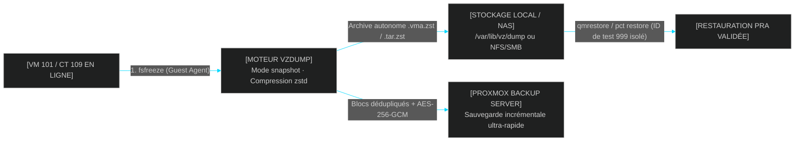

<!-- MASTER-HEADER-START -->
<div align="center">

<a href="https://0xcyberlitech.com/">
  
</a>

<p align="center">
  <a href="https://0xcyberlitech.com/"></a>
  <a href="https://0xcyberlitech.com/soc-rd.html"></a>
  <a href="https://0xcyberlitech.com/jarvis-rd.html"></a>
  <a href="https://github.com/0xCyberLiTech?tab=repositories"></a>
</p>
<p align="center">
  <a href="README.md"></a>
</p>


</div>
<!-- MASTER-HEADER-END -->

<!-- DEBIAN-TRUTH-START -->
> [!IMPORTANT]
>  ** Matrice Officielle Debian — `Debian 12 (Bookworm)` · `Debian 13 (Trixie)` · `Debian 14 (Forky)`**
> - **Sources Officielles Debian.org (`qemu`) :** `Bookworm (12)` : **`Stable-12`** &nbsp;·&nbsp; `Trixie (13 — Stable)` : **`Stable-13`** &nbsp;·&nbsp; `Forky (14 — Next-Gen)` : **`Testing-14`**
> - **Références Officielles :** [Paquet Debian Trixie (`qemu-system-x86`)](https://packages.debian.org/trixie/qemu-system-x86) &nbsp;·&nbsp; [Paquet Debian Forky (`qemu-system-x86`)](https://packages.debian.org/forky/qemu-system-x86) &nbsp;·&nbsp; [Documentation Officielle Debian](https://pve.proxmox.com/pve-docs/)
> - **Note d'Ingénierie (Divergence 13 vs 14) :** Depuis Proxmox VE 8 (Debian 12 Bookworm) et Proxmox VE 9 (Debian 13 Trixie / préparation Debian 14 Forky), les dépôts APT utilisent le format structuré **DEB822 (`/etc/apt/sources.list.d/pve-no-subscription.sources`)** et les mises à jour s'exécutent exclusivement via **`apt full-upgrade`**.

<details>
<summary> <b>Afficher les Encarts Ligne de Commande : Debian 13 (Trixie — Stable) vs Debian 14 (Forky — Next-Gen)</b></summary>

####  Profil Production Stable — Commandes pour `Debian 13 (Trixie)`
```bash
# Proxmox VE 9 (Debian 13 Trixie) — Depot officiel pve-no-subscription au format DEB822 (.sources) :
pveversion -v && pvesm status
apt update && apt full-upgrade -y
```

####  Profil Anticipation Next-Gen — Commandes pour `Debian 14 (Forky)`
```bash
# Debian 14 (Forky — Next-Gen) & Noyau Proxmox 6.14+ : Format DEB822 strict, ZFS 2.3+ & proxmox-boot-tool :
proxmox-boot-tool status && zpool status -x
qm list && pct list
```

</details>
<!-- DEBIAN-TRUTH-END -->

<!-- CIEL-PEDAGOGY-START -->
<details>
<summary> <b>Synthèse d'Architecture, Standards Officiels &amp; Diagnostic (Niveau 1 : Fondamentaux · Niveau 2 : Repères · Niveau 3 : Diagnostic)</b></summary>

- **Niveau 1 — Fondamentaux &amp; Principe d'Architecture :** **Proxmox Virtual Environment (Proxmox VE 8 & 9)** est un hyperviseur bare-metal de classe entreprise basé sur Debian combinant la virtualisation matérielle complète **KVM/QEMU (`qm`)**, les conteneurs système légers **LXC (`pct`)**, le stockage **ZFS / LVM-Thin (`pvesm`)**, la commutation réseau **Bridge/VLAN (`vmbr`)** et le pare-feu distribué **`pve-firewall`**.
- **Niveau 2 — Repères Officiels (Ports IANA, Fichiers Debian &amp; Commandes de Validation) :** **Ports Officiels :** `TCP 8006` (Web UI & API REST HTTPS) · `TCP 22` (SSH) · `TCP 5900-5999` (VNC) · `UDP 5405-5412` (Corosync Cluster) &nbsp;|&nbsp; **Fichiers clés :** `/etc/pve/` (`pmxcfs`), `/etc/network/interfaces`, `/etc/pve/storage.cfg` &nbsp;|&nbsp; **Validation officielle :** `pveversion -v && pvesm status && qm list && pct list`.
- **Niveau 3 — Diagnostic d'Incidents &amp; Ingénierie Avancée :** **Diagnostic & Architecture :** En cas de blocage de l'interface Web `:8006`, relancez `systemctl restart pveproxy pvedaemon pvestatd` (zéro coupure des VMs). Activez toujours l'`IPSet` réservé **`management`** avant d'activer `pve-firewall`, plafonnez l'ARC ZFS en RAM (`zfs_arc_max`), privilégiez les conteneurs LXC non-privilégiés (`unprivileged=1`) et validez vos sauvegardes `vzdump` (`.vma.zst` / `.tar.zst`) par un test de restauration isolé (`qmrestore --unique 1` avec `link_down=1`).
- **Sources de Vérité Officielles Éditeurs &amp; Standards :** [Documentation Officielle Proxmox VE (`pve-docs`)](https://pve.proxmox.com/pve-docs/) &nbsp;·&nbsp; [Wiki Officiel Proxmox VE](https://pve.proxmox.com/wiki/Main_Page) &nbsp;·&nbsp; [Documentation Proxmox Backup Server (PBS)](https://pbs.proxmox.com/docs/)
- **Livres Blancs &amp; 67 Podcasts Audio R&amp;D :** [Portail 0xCyberLiTech](https://0xcyberlitech.com/) &nbsp;·&nbsp; [Livre Blanc SOC Cockpit v5.5](https://0xcyberlitech.com/soc-rd.html) &nbsp;·&nbsp; [Livre Blanc JARVIS Mark-VII](https://0xcyberlitech.com/jarvis-rd.html) &nbsp;·&nbsp; [Blueprint Logiciel &amp; Matériel RTX 5080](https://0xcyberlitech.com/blueprint-jarvis.html)

</details>
<!-- CIEL-PEDAGOGY-END -->


#  Chapitre 07 — Sauvegardes, Restauration PRA (`vzdump`, `qmrestore`, `pct restore`), Scripts d'Automatisation & Proxmox Backup Server (PBS)

##  01 // COMPRENDRE LES 3 MODES DE SAUVEGARDE DE `vzdump`


Dans Proxmox VE, le moteur natif **`vzdump`** permet d'exporter une machine virtuelle KVM (`.vma.zst`) ou un conteneur LXC (`.tar.zst`) avec toute sa configuration matérielle embarquée dans une seule archive autonome.

| Mode `vzdump` | Interruption de Service | Fonctionnement Interne | Quand l'utiliser ? |
|:---|:---:|:---|:---|
| **`snapshot`** *(Recommandé)* | **`0 seconde`** (Zéro coupure) | Appelle `fsfreeze` via `qemu-guest-agent` pour vider les caches disques, puis copie les blocs à chaud | **En production quotidienne** sur toutes les VMs disposant de `qemu-guest-agent` |
| **`suspend`** | `Quelques secondes / minutes` | Met le processus en pause le temps de la synchronisation | Pour les conteneurs LXC sur un stockage ne supportant pas les snapshots |
| **`stop`** | **Arrêt complet de la VM** | Éteint proprement la VM (`shutdown`), sauvegarde à froid, puis la rallume | Avant une refonte majeure ou pour une base de données sensible sans Guest Agent |



---

##  02 // PRÉPARER UN STOCKAGE DE SAUVEGARDE DÉDIÉ (`pvesm`)


> [!IMPORTANT]
> **Règle de survie PRA (3-2-1) :** Ne laissez jamais vos sauvegardes uniquement sur le disque interne du serveur Proxmox ! Si le SSD NVMe du serveur tombe en panne matérielle, vous perdrez simultanément vos VMs et vos sauvegardes. Déclarez un partage NAS externe (NFS ou SMB/CIFS) ou répliquez systématiquement vos archives `.vma.zst` / `.tar.zst` vers un second support hors-hôte.

<!-- CODE-WINDOW-START -->
> [!CAUTION]
> 
>
> ```bash
> # Option A : Créer et enregistrer un répertoire local dédié avec rétention automatique
> mkdir -p /backup
> chmod 0750 /backup
> pvesm add dir backup-local --path /backup --content backup --prune-backups keep-last=7
>
> # Option B : Enregistrer un partage NFS d'un serveur NAS externe (ex: 192.0.2.30)
> pvesm add nfs backup-nas \
>   --server 192.0.2.30 \
>   --export /export/proxmox-backups \
>   --content backup \
>   --prune-backups keep-daily=7,keep-weekly=4,keep-monthly=3
> ```
<!-- CODE-WINDOW-END -->

---

##  03 // EXÉCUTER UNE SAUVEGARDE MANUELLE OU PLANIFIÉE (`vzdump`)


Privilégiez toujours la compression **`zstd`** (*Zstandard*) : elle est multi-threadée, beaucoup plus rapide que `gzip` et offre un excellent taux de compression.

<!-- CODE-WINDOW-START -->
> [!CAUTION]
> 
>
> ```bash
> # 1. Sauvegarder à chaud une seule machine (VM 101) vers le stockage 'backup-local'
> vzdump 101 --mode snapshot --compress zstd --storage backup-local --ionice 7
>
> # 2. Sauvegarder plusieurs machines choisies (ex: 101, 106, 108, 109)
> vzdump 101 106 108 109 --mode snapshot --compress zstd --storage backup-local
>
> # 3. Sauvegarder l'intégralité des VMs et CTs du nœud (en excluant une VM de test 999)
> vzdump --all 1 --exclude 999 --mode snapshot --compress zstd --storage backup-local
> ```
<!-- CODE-WINDOW-END -->

Contrôler les archives produites et inspecter la configuration embarquée sans restaurer :

<!-- CODE-WINDOW-START -->
> [!CAUTION]
> 
>
> ```bash
> # Lister toutes les archives de sauvegarde présentes dans le stockage
> pvesm list backup-local
>
> # Extraire et lire la configuration matérielle embarquée dans une archive .vma.zst (VM)
> zstdcat /backup/dump/vzdump-qemu-101-*.vma.zst | vma config -
>
> # Extraire et lire la configuration embarquée dans une archive .tar.zst (Conteneur LXC)
> tar --use-compress-program=zstd -xOf /backup/dump/vzdump-lxc-109-*.tar.zst ./etc/vzdump/pct.conf
> ```
<!-- CODE-WINDOW-END -->

---

##  04 // RESTAURER UNE MACHINE VIRTUELLE (`qmrestore`) OU UN CONTENEUR (`pct restore`)


> [!TIP]
> **Bonne pratique absolue en production :**
> Ne restaurez **jamais** directement par-dessus votre machine de production active (`--force 1`) sans avoir d'abord restauré l'archive sur un **nouvel identifiant libre (ex: `VMID 201`)** pour vérifier qu'elle démarre correctement !

<!-- CODE-WINDOW-START -->
> [!CAUTION]
> 
>
> ```bash
> # 1. Restaurer une VM QEMU (archive .vma.zst) sur un nouvel ID libre (201) dans 'local-lvm'
> qmrestore /backup/dump/vzdump-qemu-101-2026_11_01-18_35_00.vma.zst 201 \
>   --storage local-lvm \
>   --unique 1
>
> # 2. Restaurer un conteneur LXC (archive .tar.zst) sur un nouvel ID libre (209)
> pct restore 209 /backup/dump/vzdump-lxc-109-2026_11_01-18_40_00.tar.zst \
>   --storage local-lvm \
>   --unique 1
>
> # 3. Restaurer une VM en limitant la vitesse d'écriture disque (ex: 50 Mo/s) pour ne pas ralentir la prod
> qmrestore /backup/dump/vzdump-qemu-101-2026_11_01-18_35_00.vma.zst 201 \
>   --storage local-lvm \
>   --unique 1 \
>   --bwlimit 51200
> ```
<!-- CODE-WINDOW-END -->

*(L'option `--unique 1` régénère une adresse MAC unique, mais attention : si la VM contient une adresse IP fixe dans `/etc/network/interfaces`, déconnectez virtuellement sa carte réseau avec `link_down=1` avant de l'allumer si la VM d'origine tourne encore !)*

---

##  05 // SCRIPT COMPLET N°1 : TEST DE RESTAURATION PRA AUTOMATISÉ SANS CONFLIT IP (`proxmox-dr-test-restore.sh`)


Une sauvegarde qui n'a jamais été testée en restauration n'est pas une sauvegarde. Ce script prend automatiquement la **dernière archive `vzdump`** d'une VM de production (ex: `101`), la restaure sur un ID temporaire (`999`), **débranche virtuellement le câble réseau (`link_down=1`)** pour éviter tout conflit d'adresse IP avec la VM `101` en cours d'exécution, démarre la VM `999`, vérifie qu'elle tourne (et que `qemu-guest-agent` répond), puis nettoie intégralement la VM de test :

<!-- CODE-WINDOW-START -->
> [!CAUTION]
> 
>
> ```bash
> #!/usr/bin/env bash
> # proxmox-dr-test-restore.sh — Validation PRA automatisée d'une sauvegarde vzdump en bac à sable isolé
> # Usage : ./proxmox-dr-test-restore.sh <VMID_SOURCE> [STORAGE_CIBLE] [DUMP_DIR]
> set -euo pipefail
>
> SOURCE_VMID="${1:-101}"
> TARGET_STORAGE="${2:-local-lvm}"
> DUMP_DIR="${3:-/var/lib/vz/dump}"
> TEST_VMID="999"
>
> if [ "$(id -u)" -ne 0 ]; then
>   echo "[ERREUR] Ce script doit être exécuté en root sur l'hôte Proxmox VE." >&2
>   exit 1
> fi
>
> if qm status "$TEST_VMID" >/dev/null 2>&1 || pct status "$TEST_VMID" >/dev/null 2>&1; then
>   echo "[ERREUR] L'ID de test ${TEST_VMID} existe déjà. Choisissez un ID libre." >&2
>   exit 1
> fi
>
> LATEST_ARCHIVE=$(find "$DUMP_DIR" -maxdepth 1 -name "vzdump-qemu-${SOURCE_VMID}-*.vma.zst" | sort | tail -n 1)
> if [ -z "$LATEST_ARCHIVE" ]; then
>   echo "[ERREUR] Aucune archive vzdump-qemu-${SOURCE_VMID}-*.vma.zst trouvée dans ${DUMP_DIR}." >&2
>   exit 1
> fi
>
> echo "[1/5] Archive sélectionnée : ${LATEST_ARCHIVE}"
> echo "[2/5] Restauration vers la VM bac à sable ${TEST_VMID} (stockage: ${TARGET_STORAGE})..."
> qmrestore "$LATEST_ARCHIVE" "$TEST_VMID" --storage "$TARGET_STORAGE" --unique 1
>
> echo "[3/5] Isolation réseau anti-conflit IP (activation de link_down=1 sur net0)..."
> NET0_CONF=$(qm config "$TEST_VMID" | awk '/^net0:/ {print $2}')
> if [ -n "$NET0_CONF" ]; then
>   NET0_CLEAN=$(echo "$NET0_CONF" | sed 's/,link_down=[01]//g')
>   qm set "$TEST_VMID" --net0 "${NET0_CLEAN},link_down=1"
> fi
> qm set "$TEST_VMID" --name "dr-test-vm-${SOURCE_VMID}" --onboot 0
>
> echo "[4/5] Démarrage de la VM de test ${TEST_VMID} et vérification de santé (25s)..."
> qm start "$TEST_VMID"
> sleep 25
>
> VM_STATE=$(qm status "$TEST_VMID" | awk '{print $2}')
> echo "      -> État du processus KVM : ${VM_STATE}"
> if qm agent "$TEST_VMID" ping >/dev/null 2>&1; then
>   echo "      -> Dialogue qemu-guest-agent : OK (OS invité pleinement démarré)"
> else
>   echo "      -> Dialogue qemu-guest-agent : Non détecté (VM démarrée, vérifier console si nécessaire)"
> fi
>
> echo "[5/5] Arrêt et purge propre de la VM de test ${TEST_VMID}..."
> qm stop "$TEST_VMID" --skiplock 1
> qm destroy "$TEST_VMID" --purge 1 --destroy-unreferenced-disks 1
>
> echo "[SUCCÈS PRA] L'archive ${LATEST_ARCHIVE} a été restaurée, démarrée et validée avec 0 erreur."
> ```
<!-- CODE-WINDOW-END -->

---

##  06 // SCRIPT COMPLET N°2 : SAUVEGARDE & RESTAURATION DE LA CONFIGURATION DE L'HÔTE PROXMOX (`config.db` & `/etc/pve`)


`vzdump` sauvegarde vos machines virtuelles, mais **ne sauvegarde pas la configuration de l'hyperviseur lui-même** (vos ponts réseau `/etc/network/interfaces`, vos stockages `/etc/pve/storage.cfg`, vos règles pare-feu `/etc/pve/firewall/` et la base SQLite maîtresse `/var/lib/pve-cluster/config.db` du système `pmxcfs`).

###  A. Script d'export quotidien de la configuration de l'hôte (`proxmox-host-config-backup.sh`)

<!-- CODE-WINDOW-START -->
> [!CAUTION]
> 
>
> ```bash
> #!/usr/bin/env bash
> # proxmox-host-config-backup.sh — Sauvegarde intègre de la base pmxcfs (config.db) et de /etc
> set -euo pipefail
>
> BACKUP_ROOT="/backup/pve-host-config"
> TIMESTAMP=$(date +"%Y%m%d-%H%M%S")
> WORK_DIR=$(mktemp -d)
> ARCHIVE_PATH="${BACKUP_ROOT}/pve-host-config-$(hostname)-${TIMESTAMP}.tar.zst"
>
> mkdir -p "$BACKUP_ROOT"
> chmod 0700 "$BACKUP_ROOT"
>
> # 1. Vérifier et exporter proprement la base SQLite maîtresse de /etc/pve (pmxcfs)
> if [ -f /var/lib/pve-cluster/config.db ]; then
>   sqlite3 /var/lib/pve-cluster/config.db "PRAGMA integrity_check;" > "${WORK_DIR}/sqlite_integrity.txt"
>   sqlite3 /var/lib/pve-cluster/config.db ".backup '${WORK_DIR}/config.db'"
> fi
>
> # 2. Copier les fichiers vitaux de l'hyperviseur Proxmox VE
> cp -a /etc/pve "${WORK_DIR}/etc_pve_snapshot"
> cp -a /etc/network/interfaces "${WORK_DIR}/interfaces"
> cp -a /etc/hosts "${WORK_DIR}/hosts"
> cp -a /etc/resolv.conf "${WORK_DIR}/resolv.conf"
> cp -a /etc/fstab "${WORK_DIR}/fstab"
> cp -a /etc/apt/sources.list* "${WORK_DIR}/" 2>/dev/null || true
> cp -a /etc/modprobe.d "${WORK_DIR}/modprobe.d" 2>/dev/null || true
> pveversion -v > "${WORK_DIR}/pveversion.txt"
>
> # 3. Compresser en .tar.zst chiffrable et purger les archives de plus de 30 jours
> tar --use-compress-program=zstd -cf "$ARCHIVE_PATH" -C "$WORK_DIR" .
> chmod 0600 "$ARCHIVE_PATH"
> rm -rf "$WORK_DIR"
> find "$BACKUP_ROOT" -name "pve-host-config-*.tar.zst" -mtime +30 -delete
>
> echo "[OK] Configuration hôte Proxmox sauvegardée : ${ARCHIVE_PATH}"
> ```
<!-- CODE-WINDOW-END -->

###  B. Comment restaurer `config.db` sur un serveur Proxmox VE fraîchement réinstallé

Si le disque système de votre serveur Proxmox tombe en panne et que vous réinstallez Proxmox VE à neuf (avec le **même nom d'hôte et la même IP**), voici la procédure officielle pour retrouver instantanément tous vos stockages, règles pare-feu, jetons API et définitions de VMs :

<!-- CODE-WINDOW-START -->
> [!CAUTION]
> 
>
> ```bash
> # 1. Extraire l'archive de configuration hôte dans /tmp/restore-pve
> mkdir -p /tmp/restore-pve
> tar --use-compress-program=zstd -xf /backup/pve-host-config/pve-host-config-*.tar.zst -C /tmp/restore-pve
>
> # 2. Arrêter le démon du système de fichiers de cluster (pmxcfs)
> systemctl stop pve-cluster
>
> # 3. Remplacer la base SQLite vierge par votre base sauvegardée config.db
> cp -a /var/lib/pve-cluster/config.db /var/lib/pve-cluster/config.db.orig
> cp -a /tmp/restore-pve/config.db /var/lib/pve-cluster/config.db
> chown root:root /var/lib/pve-cluster/config.db
> chmod 0600 /var/lib/pve-cluster/config.db
>
> # 4. Restaurer la configuration réseau et relancer tous les services Proxmox VE
> cp -a /tmp/restore-pve/interfaces /etc/network/interfaces
> ifreload -a
> systemctl start pve-cluster
> systemctl restart pvedaemon pveproxy pvestatd
> ```
<!-- CODE-WINDOW-END -->

---

##  07 // PROXMOX BACKUP SERVER (PBS) & SOURCES DE VÉRITÉ OFFICIELLES


Lorsque le volume des VMs dépasse plusieurs centaines de gigaoctets, **Proxmox Backup Server (PBS)** apporte 4 avantages décisifs par rapport aux archives `vzdump` classiques :

1. **Déduplication globale par blocs (*Chunking* de 4 Mo) :** si vous sauvegardez 10 VMs Debian 13, les fichiers système identiques ne sont stockés **qu'une seule fois** (gain d'espace de 80 à 95 %).
2. **Sauvegardes incrémentales ultra-rapides (*Dirty Bitmaps* QEMU) :** après la première sauvegarde, seuls les blocs modifiés depuis la veille sont transférés sur le réseau.
3. **Chiffrement client `AES-256-GCM` :** les données sont chiffrées sur votre Proxmox VE *avant* d'être envoyées au serveur de sauvegarde.
4. **Restauration fichier par fichier (*File-Level Restore*) et *Live Restore* :** possibilité d'extraire un seul fichier depuis l'interface Web sans restaurer toute la VM, ou de démarrer la VM immédiatement pendant que ses blocs se restaurent en arrière-plan.

###  Sources de Vérité Officielles & Références Manpages

- **Proxmox VE Administration Guide — Chapter 16 : Backup and Restore (`vzdump` / `qmrestore`) :** `https://pve.proxmox.com/pve-docs/chapter-vzdump.html`
- **Proxmox VE Wiki — Backup and Restore :** `https://pve.proxmox.com/wiki/Backup_and_Restore`
- **Proxmox VE Administration Guide — Proxmox Cluster File System (`pmxcfs` / `config.db`) :** `https://pve.proxmox.com/pve-docs/chapter-pmxcfs.html`
- **Documentation Officielle Proxmox Backup Server (PBS) :** `https://pbs.proxmox.com/docs/`
- **Pages de manuel système (Manpages) :** `man 1 vzdump`, `man 1 qmrestore`, `man 1 pct`, `man 8 pmxcfs`

<!-- MASTER-FOOTER-START -->
<div align="center">


<a href="https://0xcyberlitech.com/">
  
</a>

<p align="center"><a href="https://0xcyberlitech.com/"></a></p>

<sub><b>Architecturé &amp; Forgé par Marc &amp; Antigravity (Google DeepMind)</b> &nbsp;·&nbsp; <a href="https://0xcyberlitech.com/"><b>0xcyberlitech.com</b></a> &nbsp;·&nbsp; <a href="https://0xcyberlitech.com/soc-rd.html">Architecture SOC Cockpit v5.5</a> &nbsp;·&nbsp; <a href="https://0xcyberlitech.com/jarvis-rd.html">Architecture JARVIS Mark-VII</a> &nbsp;·&nbsp; <a href="https://0xcyberlitech.com/blueprint-jarvis.html">Blueprint Matériel RTX 5080</a></sub>

</div>
<!-- MASTER-FOOTER-END -->
