<!-- MASTER-HEADER-START -->
<div align="center">

<a href="https://0xcyberlitech.com/">
  
</a>

<p align="center">
  <a href="https://0xcyberlitech.com/"></a>
  <a href="https://0xcyberlitech.com/soc-rd.html"></a>
  <a href="https://0xcyberlitech.com/jarvis-rd.html"></a>
  <a href="https://github.com/0xCyberLiTech?tab=repositories"></a>
</p>
<p align="center">
  <a href="README.md"></a>
</p>


</div>
<!-- MASTER-HEADER-END -->

<!-- DEBIAN-TRUTH-START -->
> [!IMPORTANT]
>  ** Matrice Officielle Debian — `Debian 12 (Bookworm)` · `Debian 13 (Trixie)` · `Debian 14 (Forky)`**
> - **Sources Officielles Debian.org (`qemu`) :** `Bookworm (12)` : **`Stable-12`** &nbsp;·&nbsp; `Trixie (13 — Stable)` : **`Stable-13`** &nbsp;·&nbsp; `Forky (14 — Next-Gen)` : **`Testing-14`**
> - **Références Officielles :** [Paquet Debian Trixie (`qemu-system-x86`)](https://packages.debian.org/trixie/qemu-system-x86) &nbsp;·&nbsp; [Paquet Debian Forky (`qemu-system-x86`)](https://packages.debian.org/forky/qemu-system-x86) &nbsp;·&nbsp; [Documentation Officielle Debian](https://pve.proxmox.com/pve-docs/)
> - **Note d'Ingénierie (Divergence 13 vs 14) :** Depuis Proxmox VE 8 (Debian 12 Bookworm) et Proxmox VE 9 (Debian 13 Trixie / préparation Debian 14 Forky), les dépôts APT utilisent le format structuré **DEB822 (`/etc/apt/sources.list.d/pve-no-subscription.sources`)** et les mises à jour s'exécutent exclusivement via **`apt full-upgrade`**.

<details>
<summary> <b>Afficher les Encarts Ligne de Commande : Debian 13 (Trixie — Stable) vs Debian 14 (Forky — Next-Gen)</b></summary>

####  Profil Production Stable — Commandes pour `Debian 13 (Trixie)`
```bash
# Proxmox VE 9 (Debian 13 Trixie) — Depot officiel pve-no-subscription au format DEB822 (.sources) :
pveversion -v && pvesm status
apt update && apt full-upgrade -y
```

####  Profil Anticipation Next-Gen — Commandes pour `Debian 14 (Forky)`
```bash
# Debian 14 (Forky — Next-Gen) & Noyau Proxmox 6.14+ : Format DEB822 strict, ZFS 2.3+ & proxmox-boot-tool :
proxmox-boot-tool status && zpool status -x
qm list && pct list
```

</details>
<!-- DEBIAN-TRUTH-END -->

<!-- CIEL-PEDAGOGY-START -->
<details>
<summary> <b>Synthèse d'Architecture, Standards Officiels &amp; Diagnostic (Niveau 1 : Fondamentaux · Niveau 2 : Repères · Niveau 3 : Diagnostic)</b></summary>

- **Niveau 1 — Fondamentaux &amp; Principe d'Architecture :** **Proxmox Virtual Environment (Proxmox VE 8 & 9)** est un hyperviseur bare-metal de classe entreprise basé sur Debian combinant la virtualisation matérielle complète **KVM/QEMU (`qm`)**, les conteneurs système légers **LXC (`pct`)**, le stockage **ZFS / LVM-Thin (`pvesm`)**, la commutation réseau **Bridge/VLAN (`vmbr`)** et le pare-feu distribué **`pve-firewall`**.
- **Niveau 2 — Repères Officiels (Ports IANA, Fichiers Debian &amp; Commandes de Validation) :** **Ports Officiels :** `TCP 8006` (Web UI & API REST HTTPS) · `TCP 22` (SSH) · `TCP 5900-5999` (VNC) · `UDP 5405-5412` (Corosync Cluster) &nbsp;|&nbsp; **Fichiers clés :** `/etc/pve/` (`pmxcfs`), `/etc/network/interfaces`, `/etc/pve/storage.cfg` &nbsp;|&nbsp; **Validation officielle :** `pveversion -v && pvesm status && qm list && pct list`.
- **Niveau 3 — Diagnostic d'Incidents &amp; Ingénierie Avancée :** **Diagnostic & Architecture :** En cas de blocage de l'interface Web `:8006`, relancez `systemctl restart pveproxy pvedaemon pvestatd` (zéro coupure des VMs). Activez toujours l'`IPSet` réservé **`management`** avant d'activer `pve-firewall`, plafonnez l'ARC ZFS en RAM (`zfs_arc_max`), privilégiez les conteneurs LXC non-privilégiés (`unprivileged=1`) et validez vos sauvegardes `vzdump` (`.vma.zst` / `.tar.zst`) par un test de restauration isolé (`qmrestore --unique 1` avec `link_down=1`).
- **Sources de Vérité Officielles Éditeurs &amp; Standards :** [Documentation Officielle Proxmox VE (`pve-docs`)](https://pve.proxmox.com/pve-docs/) &nbsp;·&nbsp; [Wiki Officiel Proxmox VE](https://pve.proxmox.com/wiki/Main_Page) &nbsp;·&nbsp; [Documentation Proxmox Backup Server (PBS)](https://pbs.proxmox.com/docs/)
- **Livres Blancs &amp; 67 Podcasts Audio R&amp;D :** [Portail 0xCyberLiTech](https://0xcyberlitech.com/) &nbsp;·&nbsp; [Livre Blanc SOC Cockpit v5.5](https://0xcyberlitech.com/soc-rd.html) &nbsp;·&nbsp; [Livre Blanc JARVIS Mark-VII](https://0xcyberlitech.com/jarvis-rd.html) &nbsp;·&nbsp; [Blueprint Logiciel &amp; Matériel RTX 5080](https://0xcyberlitech.com/blueprint-jarvis.html)

</details>
<!-- CIEL-PEDAGOGY-END -->


#  Chapitre 01 — Premier Démarrage, Dépôts Officiels DEB822 (`no-subscription`) & Cycle de Mise à Jour Proxmox VE

##  01 // COMPRENDRE LA LOGIQUE DES DÉPÔTS PROXMOX VE AU PREMIER DÉMARRAGE


Juste après l'installation d'un serveur **Proxmox VE 8 (`Debian 12 Bookworm`)** ou **Proxmox VE 9 (`Debian 13 Trixie`)**, toute tentative de mise à jour (`apt update`) échoue avec l'erreur **`401 Unauthorized`**.

> [!NOTE]
> **Pourquoi cette erreur `401 Unauthorized` apparaît-elle par défaut ?**
> L'image ISO officielle Proxmox active par défaut deux dépôts commerciaux (`pve-enterprise.sources` et `ceph.sources`) qui exigent une clé d'abonnement payante. Pour un laboratoire R&D, un homelab ou une pré-production sans souscription commerciale, Proxmox fournit officiellement le dépôt gratuit **`pve-no-subscription`**. Tant que cette bascule n'est pas effectuée, votre hyperviseur ne reçoit **aucun correctif de sécurité Debian ni aucune mise à jour du noyau Proxmox**.

```mermaid
%%{init: {'theme': 'dark', 'themeVariables': { 'primaryColor': '#091326', 'primaryTextColor': '#f8fafc', 'primaryBorderColor': '#00d9ff', 'lineColor': '#00d9ff', 'secondaryColor': '#060b16', 'tertiaryColor': '#0b1528'}}}%%
flowchart LR
    ISO["[INSTALLATION ISO] Proxmox VE 8 / 9"] --> ENT["[DEFAUT] pve-enterprise.sources<br/>Erreur HTTP 401 sans clé payante"]
    ENT -->|"1. Désactivation propre (.disabled)"| KEY["[TROUSSEAU GPG] Vérification Empreinte<br/>proxmox-release-trixie.gpg"]
    KEY -->|"2. Format DEB822 (.sources)"| NOSUB["[OFFICIEL] pve-no-subscription<br/>download.proxmox.com/debian/pve"]
    NOSUB -->|"3. apt full-upgrade"| UP["[PRODUCTION] Noyau & pve-manager à jour"]
```



---

##  02 // DÉSACTIVER PROPREMENT LES DÉPÔTS ENTERPRISE (SANS LES SUPPRIMER)


Ne supprimez jamais brutalement les fichiers d'origine : conservez une sauvegarde et renommez-les avec l'extension `.disabled` afin qu'APT les ignore tout en permettant un retour arrière instantané.

<!-- CODE-WINDOW-START -->
> [!CAUTION]
> 
>
> ```bash
> # 1. Sauvegarder et désactiver le dépôt pve-enterprise
> cp -a /etc/apt/sources.list.d/pve-enterprise.sources /root/pve-enterprise.sources.bak 2>/dev/null || true
> mv /etc/apt/sources.list.d/pve-enterprise.sources /etc/apt/sources.list.d/pve-enterprise.sources.disabled 2>/dev/null || true
>
> # 2. Désactiver également le dépôt Ceph Enterprise (présent par défaut sur PVE 8/9)
> cp -a /etc/apt/sources.list.d/ceph.sources /root/ceph.sources.bak 2>/dev/null || true
> mv /etc/apt/sources.list.d/ceph.sources /etc/apt/sources.list.d/ceph.sources.disabled 2>/dev/null || true
> ```
<!-- CODE-WINDOW-END -->

---

##  03 // VÉRIFIER LA CLÉ GPG OFFICIELLE PROXMOX VE


Sur une installation officielle Proxmox VE, la clé de signature est déjà présente dans `/etc/apt/trusted.gpg.d/` (ou `/usr/share/keyrings/`). Si vous transformez une Debian standard en Proxmox VE, téléchargez et vérifiez systématiquement son empreinte cryptographique officielle.

<!-- CODE-WINDOW-START -->
> [!CAUTION]
> 
>
> ```bash
> # Téléchargement officiel de la clé Proxmox VE 9 (Debian 13 Trixie)
> curl -fsSL https://enterprise.proxmox.com/debian/proxmox-release-trixie.gpg \
>   -o /etc/apt/trusted.gpg.d/proxmox-release-trixie.gpg
> chmod 0644 /etc/apt/trusted.gpg.d/proxmox-release-trixie.gpg
>
> # Vérification de l'empreinte GPG officielle
> gpg --with-fingerprint /etc/apt/trusted.gpg.d/proxmox-release-trixie.gpg
> ```
<!-- CODE-WINDOW-END -->

> [!TIP]
> **Pour Proxmox VE 8 sous Debian 12 (Bookworm) :** remplacez `trixie` par `bookworm` (`https://enterprise.proxmox.com/debian/proxmox-release-bookworm.gpg`).

---

##  04 // DÉCLARER LE DÉPÔT OFFICIEL `pve-no-subscription` AU FORMAT DEB822


Depuis Debian 12/13 et Proxmox VE 8/9, les dépôts utilisent la norme structurée **DEB822 (`.sources`)** avec liaison cryptographique explicite `Signed-By:`.

###  A. Configuration pour Proxmox VE 9 (`Debian 13 Trixie`)

<!-- CODE-WINDOW-START -->
> [!CAUTION]
> 
>
> ```bash
> cat > /etc/apt/sources.list.d/pve-no-subscription.sources <<'EOF'
> Types: deb
> URIs: http://download.proxmox.com/debian/pve
> Suites: trixie
> Components: pve-no-subscription
> Signed-By: /etc/apt/trusted.gpg.d/proxmox-release-trixie.gpg
> EOF
> ```
<!-- CODE-WINDOW-END -->

###  B. Configuration pour Proxmox VE 8 (`Debian 12 Bookworm`)

<!-- CODE-WINDOW-START -->
> [!CAUTION]
> 
>
> ```bash
> cat > /etc/apt/sources.list.d/pve-no-subscription.sources <<'EOF'
> Types: deb
> URIs: http://download.proxmox.com/debian/pve
> Suites: bookworm
> Components: pve-no-subscription
> Signed-By: /etc/apt/trusted.gpg.d/proxmox-release-bookworm.gpg
> EOF
> ```
<!-- CODE-WINDOW-END -->

---

##  05 // LA RÈGLE D'OR DES MISES À JOUR PROXMOX : `apt full-upgrade` (JAMAIS `apt upgrade`)


> [!WARNING]
> **Piège critique au quotidien : n'utilisez JAMAIS `apt upgrade` tout seul sur Proxmox VE !**
> Lorsqu'une nouvelle version du noyau `proxmox-kernel-6.x` ou de `pve-qemu-kvm` est publiée, elle introduit de nouveaux paquets binaires. La commande `apt upgrade` refuse d'installer de nouveaux paquets et laisse les bibliothèques Proxmox dans un état hybride incohérent pouvant casser le démarrage des VMs. Utilisez **exclusivement `apt full-upgrade`** (ou la commande native `pveupgrade`).

<!-- CODE-WINDOW-START -->
> [!CAUTION]
> 
>
> ```bash
> # 1. Rafraîchir l'index des dépôts Debian + Proxmox
> apt update
>
> # 2. Inspecter la liste des paquets qui vont être mis à jour
> apt list --upgradable
>
> # 3. Appliquer la mise à jour complète (ou via l'outil natif pveupgrade)
> apt full-upgrade -y
> ```
<!-- CODE-WINDOW-END -->

---

##  06 // CONTRÔLE POST-MISE À JOUR & VÉRIFICATION DU NOYAU ACTIF


Après la mise à jour, vérifiez toujours que les paquets proviennent bien du dépôt officiel et contrôlez si un nouveau noyau attend un redémarrage planifié :

<!-- CODE-WINDOW-START -->
> [!CAUTION]
> 
>
> ```bash
> # Vérifier l'origine du paquet pve-manager
> apt policy pve-manager
>
> # Afficher le bilan complet des versions de tous les composants Proxmox VE
> pveversion -v
>
> # Comparer le noyau en cours d'exécution avec le dernier noyau installé
> uname -r
> dpkg -l | grep proxmox-kernel
> ```
<!-- CODE-WINDOW-END -->

---

##  07 // SOURCES DE VÉRITÉ OFFICIELLES & RÉFÉRENCES MANPAGES


- **Proxmox VE Administration Guide — Package Repositories (`DEB822` `.sources`) :** `https://pve.proxmox.com/pve-docs/chapter-sysadmin.html#sysadmin_package_repositories`
- **Proxmox VE Wiki — Package Repositories (`pve-no-subscription` & Clés GPG) :** `https://pve.proxmox.com/wiki/Package_Repositories`
- **Proxmox VE Wiki — Upgrade from 8 to 9 (`pve8to9 --full`) :** `https://pve.proxmox.com/wiki/Upgrade_from_8_to_9`
- **Pages de manuel système (Manpages) :** `man 5 sources.list`, `man 8 apt`, `man 1 pveversion`, `man 1 pveupgrade`

<!-- MASTER-FOOTER-START -->
<div align="center">


<a href="https://0xcyberlitech.com/">
  
</a>

<p align="center"><a href="https://0xcyberlitech.com/"></a></p>

<sub><b>Architecturé &amp; Forgé par Marc &amp; Antigravity (Google DeepMind)</b> &nbsp;·&nbsp; <a href="https://0xcyberlitech.com/"><b>0xcyberlitech.com</b></a> &nbsp;·&nbsp; <a href="https://0xcyberlitech.com/soc-rd.html">Architecture SOC Cockpit v5.5</a> &nbsp;·&nbsp; <a href="https://0xcyberlitech.com/jarvis-rd.html">Architecture JARVIS Mark-VII</a> &nbsp;·&nbsp; <a href="https://0xcyberlitech.com/blueprint-jarvis.html">Blueprint Matériel RTX 5080</a></sub>

</div>
<!-- MASTER-FOOTER-END -->
