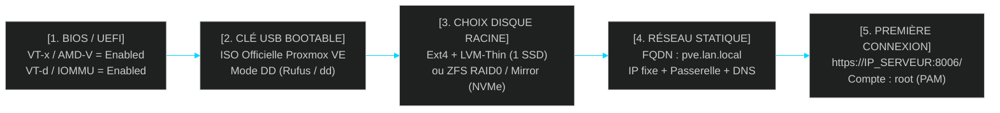

<!-- MASTER-HEADER-START -->
<div align="center">

<a href="https://0xcyberlitech.com/">
  
</a>

<p align="center">
  <a href="https://0xcyberlitech.com/"></a>
  <a href="https://0xcyberlitech.com/soc-rd.html"></a>
  <a href="https://0xcyberlitech.com/jarvis-rd.html"></a>
  <a href="https://github.com/0xCyberLiTech?tab=repositories"></a>
</p>
<p align="center">
  <a href="README.md"></a>
</p>


</div>
<!-- MASTER-HEADER-END -->

<!-- DEBIAN-TRUTH-START -->
> [!IMPORTANT]
>  ** Matrice Officielle Debian — `Debian 12 (Bookworm)` · `Debian 13 (Trixie)` · `Debian 14 (Forky)`**
> - **Sources Officielles Debian.org (`qemu`) :** `Bookworm (12)` : **`Stable-12`** &nbsp;·&nbsp; `Trixie (13 — Stable)` : **`Stable-13`** &nbsp;·&nbsp; `Forky (14 — Next-Gen)` : **`Testing-14`**
> - **Références Officielles :** [Paquet Debian Trixie (`qemu-system-x86`)](https://packages.debian.org/trixie/qemu-system-x86) &nbsp;·&nbsp; [Paquet Debian Forky (`qemu-system-x86`)](https://packages.debian.org/forky/qemu-system-x86) &nbsp;·&nbsp; [Documentation Officielle Debian](https://pve.proxmox.com/pve-docs/)
> - **Note d'Ingénierie (Divergence 13 vs 14) :** Depuis Proxmox VE 8 (Debian 12 Bookworm) et Proxmox VE 9 (Debian 13 Trixie / préparation Debian 14 Forky), les dépôts APT utilisent le format structuré **DEB822 (`/etc/apt/sources.list.d/pve-no-subscription.sources`)** et les mises à jour s'exécutent exclusivement via **`apt full-upgrade`**.

<details>
<summary> <b>Afficher les Encarts Ligne de Commande : Debian 13 (Trixie — Stable) vs Debian 14 (Forky — Next-Gen)</b></summary>

####  Profil Production Stable — Commandes pour `Debian 13 (Trixie)`
```bash
# Proxmox VE 9 (Debian 13 Trixie) — Depot officiel pve-no-subscription au format DEB822 (.sources) :
pveversion -v && pvesm status
apt update && apt full-upgrade -y
```

####  Profil Anticipation Next-Gen — Commandes pour `Debian 14 (Forky)`
```bash
# Debian 14 (Forky — Next-Gen) & Noyau Proxmox 6.14+ : Format DEB822 strict, ZFS 2.3+ & proxmox-boot-tool :
proxmox-boot-tool status && zpool status -x
qm list && pct list
```

</details>
<!-- DEBIAN-TRUTH-END -->

<!-- CIEL-PEDAGOGY-START -->
<details>
<summary> <b>Synthèse d'Architecture, Standards Officiels &amp; Diagnostic (Niveau 1 : Fondamentaux · Niveau 2 : Repères · Niveau 3 : Diagnostic)</b></summary>

- **Niveau 1 — Fondamentaux &amp; Principe d'Architecture :** **Proxmox Virtual Environment (Proxmox VE 8 & 9)** est un hyperviseur bare-metal de classe entreprise basé sur Debian combinant la virtualisation matérielle complète **KVM/QEMU (`qm`)**, les conteneurs système légers **LXC (`pct`)**, le stockage **ZFS / LVM-Thin (`pvesm`)**, la commutation réseau **Bridge/VLAN (`vmbr`)** et le pare-feu distribué **`pve-firewall`**.
- **Niveau 2 — Repères Officiels (Ports IANA, Fichiers Debian &amp; Commandes de Validation) :** **Ports Officiels :** `TCP 8006` (Web UI & API REST HTTPS) · `TCP 22` (SSH) · `TCP 5900-5999` (VNC) · `UDP 5405-5412` (Corosync Cluster) &nbsp;|&nbsp; **Fichiers clés :** `/etc/pve/` (`pmxcfs`), `/etc/network/interfaces`, `/etc/pve/storage.cfg` &nbsp;|&nbsp; **Validation officielle :** `pveversion -v && pvesm status && qm list && pct list`.
- **Niveau 3 — Diagnostic d'Incidents &amp; Ingénierie Avancée :** **Diagnostic & Architecture :** En cas de blocage de l'interface Web `:8006`, relancez `systemctl restart pveproxy pvedaemon pvestatd` (zéro coupure des VMs). Activez toujours l'`IPSet` réservé **`management`** avant d'activer `pve-firewall`, plafonnez l'ARC ZFS en RAM (`zfs_arc_max`), privilégiez les conteneurs LXC non-privilégiés (`unprivileged=1`) et validez vos sauvegardes `vzdump` (`.vma.zst` / `.tar.zst`) par un test de restauration isolé (`qmrestore --unique 1` avec `link_down=1`).
- **Sources de Vérité Officielles Éditeurs &amp; Standards :** [Documentation Officielle Proxmox VE (`pve-docs`)](https://pve.proxmox.com/pve-docs/) &nbsp;·&nbsp; [Wiki Officiel Proxmox VE](https://pve.proxmox.com/wiki/Main_Page) &nbsp;·&nbsp; [Documentation Proxmox Backup Server (PBS)](https://pbs.proxmox.com/docs/)
- **Livres Blancs &amp; 67 Podcasts Audio R&amp;D :** [Portail 0xCyberLiTech](https://0xcyberlitech.com/) &nbsp;·&nbsp; [Livre Blanc SOC Cockpit v5.5](https://0xcyberlitech.com/soc-rd.html) &nbsp;·&nbsp; [Livre Blanc JARVIS Mark-VII](https://0xcyberlitech.com/jarvis-rd.html) &nbsp;·&nbsp; [Blueprint Logiciel &amp; Matériel RTX 5080](https://0xcyberlitech.com/blueprint-jarvis.html)

</details>
<!-- CIEL-PEDAGOGY-END -->


#  Chapitre 00 — Monter son Serveur Proxmox VE de Zéro : Réglages BIOS/UEFI, Clé USB Bootable & Installation ISO Pas à Pas

##  01 // PRÉPARATION MATÉRIELLE & LES 6 RÉGLAGES BIOS / UEFI INDISPENSABLES AVANT L'INSTALLATION


Avant même d'insérer la clé USB d'installation de **Proxmox VE 8 (`Debian 12 Bookworm`)** ou **Proxmox VE 9 (`Debian 13 Trixie`)**, entrez dans le BIOS/UEFI de votre serveur ou mini-PC (touche `Suppr`, `F2` ou `F12`) et validez ces **6 paramètres matériels critiques** :

| Paramètre BIOS / UEFI | Appellation Intel | Appellation AMD | Valeur Requise | Pourquoi c'est obligatoire pour Proxmox VE |
|:---|:---|:---|:---:|:---|
| **Virtualisation CPU** | `Intel VT-x` (`VMX`) | `AMD-V` (`SVM Mode`) | **`Enabled`** | Obligatoire pour démarrer la moindre machine virtuelle KVM (`qm`) |
| **Virtualisation E/S (IOMMU)** | `Intel VT-d` | `AMD IOMMU` | **`Enabled`** | Indispensable pour isoler et dédier une carte PCIe (GPU, carte 10G, NVMe) à une VM |
| **Adressage PCIe 64 bits** | `Above 4G Decoding` | `Above 4G Decoding` | **`Enabled`** | Requis pour les cartes graphiques modernes (RTX / Radeon) et les contrôleurs NVMe multiples |
| **Accès Mémoire BAR** | `Resizable BAR` (`Re-Size BAR`) | `Smart Access Memory` | **`Enabled`** | Optimise les transferts mémoire vers les GPU et accélérateurs IA |
| **Virtualisation Réseau** | `SR-IOV Support` | `SR-IOV Support` | **`Enabled`** | Permet de découper une carte réseau physique 10G/25G (Intel X710/I226) en plusieurs fonctions virtuelles (`VF`) |
| **Démarrage Sécurisé** | `Secure Boot` | `Secure Boot` | **`Disabled`** *(Recommandé)* | Proxmox VE supporte Secure Boot, mais le désactiver facilite le chargement de modules noyau tiers (pilotes NVIDIA DKMS / Realtek) |



---

##  02 // TÉLÉCHARGER L'ISO OFFICIELLE ET CRÉER LA CLÉ USB BOOTABLE (PIÈGE DU MODE `DD`)


1. Téléchargez l'image ISO officielle sur **`https://www.proxmox.com/en/downloads`** (`Proxmox VE 8.x / 9.x ISO Installer`).
2. Vérifiez toujours l'empreinte cryptographique **`SHA256SUM`** affichée sur le site officiel avant de flasher la clé.

> [!WARNING]
> **Piège classique avec Rufus sous Windows : choisissez impérativement le « Mode Image DD » !**
> L'ISO de Proxmox VE possède une table de partition hybride spécifique. Si vous la flashez en mode « ISO » classique dans Rufus, l'installateur plantera au démarrage avec l'erreur `No CD-ROM found`. Utilisez **Rufus en mode `Écrire en mode Image DD`**, **BalenaEtcher** ou **Ventoy (en choisissant `Boot in GRUB2 mode`)**.

Sous Linux ou macOS, flashez directement la clé USB avec `dd` :

<!-- CODE-WINDOW-START -->
> [!CAUTION]
> 
>
> ```bash
> # Identifier la clé USB (ex: /dev/sdb — ATTENTION à ne pas vous tromper de disque !)
> lsblk
>
> # Flasher l'ISO Proxmox VE en écriture directe synchronisée
> sudo dd bs=1M conv=fdatasync if=./proxmox-ve_*.iso of=/dev/sdX status=progress
> ```
<!-- CODE-WINDOW-END -->

---

##  03 // ÉCRAN PAR ÉCRAN : L'INSTALLATEUR GRAPHIQUE PROXMOX VE EXPLIQUÉ


###  A. Écran « Target Harddisk » : faut-il choisir `ext4` (LVM-Thin) ou `ZFS` ?

Cliquez sur le bouton **`Options`** à côté du disque cible :

| Configuration Matérielle de votre Serveur | Choix Recommandé dans `Filesystem` | Réglages Avancés (`Options`) Recommandés |
|:---|:---|:---|
| **1 seul SSD/NVMe et `<= 16 Go` de RAM** | **`ext4`** *(Crée automatiquement `local` + `local-lvm`)* | `maxroot`: `32` à `64` Go · `minfree`: `16` Go (réserve de sécurité LVM) |
| **1 seul gros NVMe (`1 To à 4 To`) et `>= 32 Go` de RAM** | **`zfs (RAID0)`** *(Compression `lz4` + Snapshots instantanés)* | `ashift`: `12` · `compress`: `lz4` · `hdsize`: taille totale |
| **2 SSD/NVMe identiques (Redondance matérielle)** | **`zfs (RAID1)`** *(Miroir ZFS tolérant la perte d'un disque)* | `ashift`: `12` · `compress`: `lz4` |

###  B. Écran « Management Network Configuration » : le choix de la carte réseau et du FQDN

> [!IMPORTANT]
> **Comment reconnaître la bonne carte réseau si votre serveur en possède plusieurs (`eno1`, `enp2s0`, `enp3s0`) ?**
> Dans le menu déroulant **`Management Interface`**, Proxmox VE affiche un petit **point vert (ou la mention `UP`)** uniquement devant l'interface où votre câble RJ45/SFP+ est physiquement branché et synchronisé avec votre switch !

Remplissez les 4 champs réseau avec soin :
- **`Hostname (FQDN)` :** doit obligatoirement contenir un point (ex: **`pve.homelab.lan`** ou **`pve.infra.local`**, jamais `pve` tout seul).
- **`IP Address (CIDR)` :** attribuez une **adresse IP fixe en dehors de la plage DHCP** de votre routeur (ex: `192.0.2.20/24`).
- **`Gateway` :** l'adresse IP de votre routeur/pare-feu (ex: `192.0.2.1`).
- **`DNS Server` :** l'adresse IP de votre routeur ou d'un résolveur DNS fiable (`1.1.1.1` / `9.9.9.9`).

---

##  04 // PREMIÈRE CONNEXION WEB (`:8006`) & MODIFICATION D'IP APRÈS COUP


Une fois le serveur redémarré et la clé USB retirée :
1. Ouvrez votre navigateur sur **`https://192.0.2.20:8006/`** (n'oubliez pas le **`https://`** et le port **`:8006`**).
2. Acceptez l'avertissement du certificat auto-signé initial.
3. Connectez-vous avec :
   - **User name :** `root`
   - **Password :** le mot de passe défini à l'installation
   - **Realm :** `Linux PAM standard authentication`

> [!TIP]
> **Que faire si vous changez de routeur ou de sous-réseau IP après l'installation ?**
> Si vous devez changer l'adresse IP de votre serveur Proxmox VE plus tard, il faut impérativement modifier **deux fichiers** simultanément (`/etc/network/interfaces` **ET** `/etc/hosts`), sinon le système de fichiers de cluster `pmxcfs` (`/etc/pve`) refusera de démarrer en écriture !

<!-- CODE-WINDOW-START -->
> [!CAUTION]
> 
>
> ```bash
> # 1. Mettre à jour l'adresse IP et la passerelle sur vmbr0 :
> nano /etc/network/interfaces
>
> # 2. Mettre à jour l'adresse IP associée au nom d'hôte pve dans /etc/hosts (OBLIGATOIRE) :
> nano /etc/hosts
>
> # 3. Appliquer le changement réseau et redémarrer le démon de cluster local :
> ifreload -a
> systemctl restart pve-cluster pveproxy pvedaemon
> ```
<!-- CODE-WINDOW-END -->

---

##  05 // SOURCES DE VÉRITÉ OFFICIELLES & RÉFÉRENCES MANPAGES


- **Proxmox VE Administration Guide — Chapter 2 : Installing Proxmox VE :** `https://pve.proxmox.com/pve-docs/chapter-pve-installation.html`
- **Proxmox VE Wiki — Prepare Installation Media (Mode Image DD / USB) :** `https://pve.proxmox.com/wiki/Prepare_Installation_Media`
- **Proxmox VE Administration Guide — Host Bootloader (`proxmox-boot-tool` / UEFI / ZFS) :** `https://pve.proxmox.com/pve-docs/chapter-sysadmin.html#sysadmin_booting`
- **Téléchargements Officiels & Empreintes `SHA256SUM` Proxmox Server Solutions GmbH :** `https://www.proxmox.com/en/downloads`

<!-- MASTER-FOOTER-START -->
<div align="center">


<a href="https://0xcyberlitech.com/">
  
</a>

<p align="center"><a href="https://0xcyberlitech.com/"></a></p>

<sub><b>Architecturé &amp; Forgé par Marc &amp; Antigravity (Google DeepMind)</b> &nbsp;·&nbsp; <a href="https://0xcyberlitech.com/"><b>0xcyberlitech.com</b></a> &nbsp;·&nbsp; <a href="https://0xcyberlitech.com/soc-rd.html">Architecture SOC Cockpit v5.5</a> &nbsp;·&nbsp; <a href="https://0xcyberlitech.com/jarvis-rd.html">Architecture JARVIS Mark-VII</a> &nbsp;·&nbsp; <a href="https://0xcyberlitech.com/blueprint-jarvis.html">Blueprint Matériel RTX 5080</a></sub>

</div>
<!-- MASTER-FOOTER-END -->
