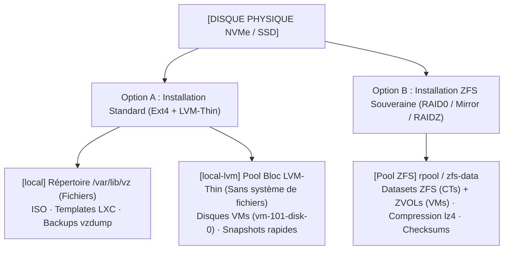

<!-- MASTER-HEADER-START -->
<div align="center">

<a href="https://0xcyberlitech.com/">
  
</a>

<p align="center">
  <a href="https://0xcyberlitech.com/"></a>
  <a href="https://0xcyberlitech.com/soc-rd.html"></a>
  <a href="https://0xcyberlitech.com/jarvis-rd.html"></a>
  <a href="https://github.com/0xCyberLiTech?tab=repositories"></a>
</p>
<p align="center">
  <a href="README.md"></a>
</p>


</div>
<!-- MASTER-HEADER-END -->

<!-- DEBIAN-TRUTH-START -->
> [!IMPORTANT]
>  ** Matrice Officielle Debian — `Debian 12 (Bookworm)` · `Debian 13 (Trixie)` · `Debian 14 (Forky)`**
> - **Sources Officielles Debian.org (`qemu`) :** `Bookworm (12)` : **`Stable-12`** &nbsp;·&nbsp; `Trixie (13 — Stable)` : **`Stable-13`** &nbsp;·&nbsp; `Forky (14 — Next-Gen)` : **`Testing-14`**
> - **Références Officielles :** [Paquet Debian Trixie (`qemu-system-x86`)](https://packages.debian.org/trixie/qemu-system-x86) &nbsp;·&nbsp; [Paquet Debian Forky (`qemu-system-x86`)](https://packages.debian.org/forky/qemu-system-x86) &nbsp;·&nbsp; [Documentation Officielle Debian](https://pve.proxmox.com/pve-docs/)
> - **Note d'Ingénierie (Divergence 13 vs 14) :** Depuis Proxmox VE 8 (Debian 12 Bookworm) et Proxmox VE 9 (Debian 13 Trixie / préparation Debian 14 Forky), les dépôts APT utilisent le format structuré **DEB822 (`/etc/apt/sources.list.d/pve-no-subscription.sources`)** et les mises à jour s'exécutent exclusivement via **`apt full-upgrade`**.

<details>
<summary> <b>Afficher les Encarts Ligne de Commande : Debian 13 (Trixie — Stable) vs Debian 14 (Forky — Next-Gen)</b></summary>

####  Profil Production Stable — Commandes pour `Debian 13 (Trixie)`
```bash
# Proxmox VE 9 (Debian 13 Trixie) — Depot officiel pve-no-subscription au format DEB822 (.sources) :
pveversion -v && pvesm status
apt update && apt full-upgrade -y
```

####  Profil Anticipation Next-Gen — Commandes pour `Debian 14 (Forky)`
```bash
# Debian 14 (Forky — Next-Gen) & Noyau Proxmox 6.14+ : Format DEB822 strict, ZFS 2.3+ & proxmox-boot-tool :
proxmox-boot-tool status && zpool status -x
qm list && pct list
```

</details>
<!-- DEBIAN-TRUTH-END -->

<!-- CIEL-PEDAGOGY-START -->
<details>
<summary> <b>Synthèse d'Architecture, Standards Officiels &amp; Diagnostic (Niveau 1 : Fondamentaux · Niveau 2 : Repères · Niveau 3 : Diagnostic)</b></summary>

- **Niveau 1 — Fondamentaux &amp; Principe d'Architecture :** **Proxmox Virtual Environment (Proxmox VE 8 & 9)** est un hyperviseur bare-metal de classe entreprise basé sur Debian combinant la virtualisation matérielle complète **KVM/QEMU (`qm`)**, les conteneurs système légers **LXC (`pct`)**, le stockage **ZFS / LVM-Thin (`pvesm`)**, la commutation réseau **Bridge/VLAN (`vmbr`)** et le pare-feu distribué **`pve-firewall`**.
- **Niveau 2 — Repères Officiels (Ports IANA, Fichiers Debian &amp; Commandes de Validation) :** **Ports Officiels :** `TCP 8006` (Web UI & API REST HTTPS) · `TCP 22` (SSH) · `TCP 5900-5999` (VNC) · `UDP 5405-5412` (Corosync Cluster) &nbsp;|&nbsp; **Fichiers clés :** `/etc/pve/` (`pmxcfs`), `/etc/network/interfaces`, `/etc/pve/storage.cfg` &nbsp;|&nbsp; **Validation officielle :** `pveversion -v && pvesm status && qm list && pct list`.
- **Niveau 3 — Diagnostic d'Incidents &amp; Ingénierie Avancée :** **Diagnostic & Architecture :** En cas de blocage de l'interface Web `:8006`, relancez `systemctl restart pveproxy pvedaemon pvestatd` (zéro coupure des VMs). Activez toujours l'`IPSet` réservé **`management`** avant d'activer `pve-firewall`, plafonnez l'ARC ZFS en RAM (`zfs_arc_max`), privilégiez les conteneurs LXC non-privilégiés (`unprivileged=1`) et validez vos sauvegardes `vzdump` (`.vma.zst` / `.tar.zst`) par un test de restauration isolé (`qmrestore --unique 1` avec `link_down=1`).
- **Sources de Vérité Officielles Éditeurs &amp; Standards :** [Documentation Officielle Proxmox VE (`pve-docs`)](https://pve.proxmox.com/pve-docs/) &nbsp;·&nbsp; [Wiki Officiel Proxmox VE](https://pve.proxmox.com/wiki/Main_Page) &nbsp;·&nbsp; [Documentation Proxmox Backup Server (PBS)](https://pbs.proxmox.com/docs/)
- **Livres Blancs &amp; 67 Podcasts Audio R&amp;D :** [Portail 0xCyberLiTech](https://0xcyberlitech.com/) &nbsp;·&nbsp; [Livre Blanc SOC Cockpit v5.5](https://0xcyberlitech.com/soc-rd.html) &nbsp;·&nbsp; [Livre Blanc JARVIS Mark-VII](https://0xcyberlitech.com/jarvis-rd.html) &nbsp;·&nbsp; [Blueprint Logiciel &amp; Matériel RTX 5080](https://0xcyberlitech.com/blueprint-jarvis.html)

</details>
<!-- CIEL-PEDAGOGY-END -->


#  Chapitre 02 — Architecture du Stockage Proxmox VE : `local`, `local-lvm`, ZFS (`zpool`/`zfs`), ARC RAM & Snapshots

##  01 // POURQUOI LE STOCKAGE PROXMOX DÉROUTE SOUVENT AU QUOTIDIEN


Après l'installation de Proxmox VE, l'interface affiche par défaut deux stockages distincts (`local` et `local-lvm` ou `local-zfs`). C'est l'un des points où l'on se perd le plus souvent : **où sont stockées les images ISO ? Où vivent les disques des VMs ? Pourquoi `ls /var/lib/vz/images` est-il vide sur un stockage LVM-Thin ou ZFS ?**



---

##  02 // COMPARATIF OPÉRATIONNEL DES 4 MOTEURS DE STOCKAGE PROXMOX


| Identifiant | Type Proxmox (`pvesm`) | Chemin Physique sur l'Hôte | Ce qu'on y stocke | Snapshots à chaud |
|:---|:---|:---|:---|:---:|
| **`local`** | `dir` (Répertoire POSIX) | `/var/lib/vz/` (`template/iso`, `dump`) | Images **ISO**, Templates **LXC**, Sauvegardes **`vzdump`** | Uniquement si disque `qcow2` |
| **`local-lvm`** | `lvmthin` (Périphérique bloc) | `/dev/pve/data` (Pas de dossier visible) | Disques de **VMs KVM** et **Conteneurs LXC** | **OUI** (Natif & rapide) |
| **`local-zfs` / `zfs-data`** | `zfspool` (Système de fichiers & Blocs) | `/zfs-data` + `/dev/zvol/zfs-data/...` | Disques **VMs (`zvol`)**, **CTs (`subvol`)**, Snapshots, Réplication | **OUI** (Instantané & atomique) |
| **`backup-nfs` / `cifs`** | `nfs` / `cifs` (Partage réseau) | `/mnt/pve/<nom>` | Sauvegardes **`vzdump`** déportées sur NAS externe | Non recommandé pour VMs live |

> [!IMPORTANT]
> **Pourquoi vous ne voyez pas vos disques de VMs avec `ls` sur `local-lvm` ou `ZFS` :**
> Sur `local-lvm` et `ZFS`, les disques des machines virtuelles ne sont pas des fichiers `.qcow2` posés dans un dossier : ce sont des **volumes blocs directs** (`LVM Logical Volumes` ou `ZFS ZVOLs`). Pour les lister en ligne de commande, on utilise **`pvesm list <storage>`**, **`lvs`** (pour LVM) ou **`zfs list`** (pour ZFS).

---

##  03 // INSPECTER L'ÉTAT DE TOUS LES STOCKAGES EN LIGNE DE COMMANDE (`pvesm`)


L'outil officiel Proxmox de gestion du stockage est **`pvesm` (*Proxmox VE Storage Manager*)** :

<!-- CODE-WINDOW-START -->
> [!CAUTION]
> 
>
> ```bash
> # 1. Afficher le statut, le type et le taux de remplissage de tous les stockages
> pvesm status
>
> # 2. Lister tous les disques de VMs et CTs présents sur local-lvm ou zfs-data
> pvesm list local-lvm
> pvesm list local
>
> # 3. Afficher la configuration déclarative des stockages Proxmox
> cat /etc/pve/storage.cfg
> ```
<!-- CODE-WINDOW-END -->

---

##  04 // MAÎTRISER ZFS SUR PROXMOX VE (`zpool` & `zfs`)


**ZFS** est le système de fichiers de référence sous Proxmox VE : il vérifie l'intégrité de chaque bloc par somme de contrôle (auto-guérison contre la corruption silencieuse *bit-rot*), compresse à la volée en **`lz4`** sans pénalité CPU, et permet des snapshots instantanés.

###  A. Créer et déclarer un Pool ZFS dédié sur un disque NVMe secondaire

<!-- CODE-WINDOW-START -->
> [!CAUTION]
> 
>
> ```bash
> # 1. Identifier le disque NVMe vierge par son identifiant matériel stable (/dev/disk/by-id/)
> ls -l /dev/disk/by-id/ | grep -v part
>
> # 2. Créer un pool ZFS optimisé pour SSD/NVMe (ashift=12 pour secteurs 4K)
> zpool create -f -o ashift=12 zfs-data /dev/disk/by-id/nvme-MODEL_SERIAL
>
> # 3. Activer la compression rapide lz4 et désactiver la mise à jour des dates de lecture (atime)
> zfs set compression=lz4 zfs-data
> zfs set atime=off zfs-data
>
> # 4. Enregistrer le pool ZFS dans Proxmox VE avec support du Thin Provisioning (--sparse 1)
> pvesm add zfspool zfs-data -pool zfs-data -content images,rootdir -sparse 1
> ```
<!-- CODE-WINDOW-END -->

###  B. Commandes quotidiennes de contrôle de santé ZFS

<!-- CODE-WINDOW-START -->
> [!CAUTION]
> 
>
> ```bash
> # Vérifier l'état de santé du pool et l'absence d'erreurs READ / WRITE / CKSUM
> zpool status -v
>
> # Vérifier l'espace réellement alloué et le ratio de compression (compressratio)
> zpool list
> zfs get compressratio,used,available zfs-data
>
> # Lancer manuellement une vérification d'intégrité (Scrubbing mensuel)
> zpool scrub zfs-data
> ```
<!-- CODE-WINDOW-END -->

---

##  05 // RÉGLAGE CRITIQUE : PLAFONNER LA MÉMOIRE VIVE DU CACHE ZFS (ARC RAM)


> [!WARNING]
> **Pourquoi votre serveur Proxmox affiche-t-il parfois 90 % de RAM utilisée avec ZFS ?**
> Sur Proxmox VE, le cache de lecture en mémoire vive de ZFS (**ARC — *Adaptive Replacement Cache***) peut consommer jusqu'à 50 % de la RAM physique du serveur. Sur un nœud de 32 Go ou 64 Go hébergeant de nombreuses VMs, un ARC non plafonné réduit la mémoire immédiatement disponible au démarrage d'une grosse VM. **La bonne pratique officielle consiste à plafonner l'ARC ZFS entre 4 Go et 8 Go.**

<!-- CODE-WINDOW-START -->
> [!CAUTION]
> 
>
> ```bash
> # Exemple : plafonner l'ARC ZFS à 8 Go (8 * 1024 * 1024 * 1024 = 8589934592 octets)
> cat > /etc/modprobe.d/zfs.conf <<'EOF'
> # Plafond ZFS ARC : 4 Go min / 8 Go max
> options zfs zfs_arc_min=4294967296
> options zfs zfs_arc_max=8589934592
> EOF
>
> # Appliquer immédiatement à chaud sans redémarrer le serveur Proxmox :
> echo 8589934592 > /sys/module/zfs/parameters/zfs_arc_max
>
> # Mettre à jour l'initramfs pour conserver le réglage au prochain reboot :
> update-initramfs -u -k all
>
> # Vérifier la taille actuelle de l'ARC ZFS :
> arc_summary | head -n 25
> ```
<!-- CODE-WINDOW-END -->

---

##  06 // PRENDRE ET RESTAURER UN SNAPSHOT AVANT UNE OPÉRATION RISQUÉE


Avant toute mise à jour majeure ou modification de configuration dans une VM ou un conteneur LXC, prenez un **snapshot instantané** (qui s'exécute en moins d'une seconde sur ZFS ou LVM-Thin) :

<!-- CODE-WINDOW-START -->
> [!CAUTION]
> 
>
> ```bash
> # 1. Prendre un snapshot d'une VM (ID 101) ou d'un conteneur LXC (ID 109)
> qm snapshot 101 avant_maj_debian --description "Snapshot de sécurité avant apt full-upgrade"
> pct snapshot 109 avant_modif_conf
>
> # 2. Lister les snapshots existants d'une VM ou d'un conteneur
> qm listsnapshot 101
> pct listsnapshot 109
>
> # 3. Revenir instantanément à l'état du snapshot en cas d'erreur (Rollback)
> qm rollback 101 avant_maj_debian
> pct rollback 109 avant_modif_conf
>
> # 4. Supprimer le snapshot une fois la mise à jour validée (ne laissez pas vieillir les snapshots)
> qm delsnapshot 101 avant_maj_debian
> pct delsnapshot 109 avant_modif_conf
> ```
<!-- CODE-WINDOW-END -->

---

##  07 // SOURCES DE VÉRITÉ OFFICIELLES & RÉFÉRENCES MANPAGES


- **Proxmox VE Administration Guide — Chapter 7 : Proxmox VE Storage (`pvesm`) :** `https://pve.proxmox.com/pve-docs/chapter-pvesm.html`
- **Proxmox VE Administration Guide — ZFS on Linux & Limit ZFS Memory Usage (`zfs_arc_max`) :** `https://pve.proxmox.com/pve-docs/chapter-sysadmin.html#chapter_zfs`
- **Proxmox VE Administration Guide — LVM Manager (`local-lvm` Thin Pool) :** `https://pve.proxmox.com/pve-docs/chapter-lvm.html`
- **Pages de manuel système (Manpages) :** `man 1 pvesm`, `man 8 zpool`, `man 8 zfs`, `man 8 lvs`

<!-- MASTER-FOOTER-START -->
<div align="center">


<a href="https://0xcyberlitech.com/">
  
</a>

<p align="center"><a href="https://0xcyberlitech.com/"></a></p>

<sub><b>Architecturé &amp; Forgé par Marc &amp; Antigravity (Google DeepMind)</b> &nbsp;·&nbsp; <a href="https://0xcyberlitech.com/"><b>0xcyberlitech.com</b></a> &nbsp;·&nbsp; <a href="https://0xcyberlitech.com/soc-rd.html">Architecture SOC Cockpit v5.5</a> &nbsp;·&nbsp; <a href="https://0xcyberlitech.com/jarvis-rd.html">Architecture JARVIS Mark-VII</a> &nbsp;·&nbsp; <a href="https://0xcyberlitech.com/blueprint-jarvis.html">Blueprint Matériel RTX 5080</a></sub>

</div>
<!-- MASTER-FOOTER-END -->
