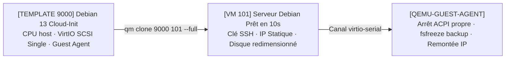

<!-- MASTER-HEADER-START -->
<div align="center">

<a href="https://0xcyberlitech.com/">
  
</a>

<p align="center">
  <a href="https://0xcyberlitech.com/"></a>
  <a href="https://0xcyberlitech.com/soc-rd.html"></a>
  <a href="https://0xcyberlitech.com/jarvis-rd.html"></a>
  <a href="https://github.com/0xCyberLiTech?tab=repositories"></a>
</p>
<p align="center">
  <a href="README.md"></a>
</p>


</div>
<!-- MASTER-HEADER-END -->

<!-- DEBIAN-TRUTH-START -->
> [!IMPORTANT]
>  ** Matrice Officielle Debian — `Debian 12 (Bookworm)` · `Debian 13 (Trixie)` · `Debian 14 (Forky)`**
> - **Sources Officielles Debian.org (`qemu`) :** `Bookworm (12)` : **`Stable-12`** &nbsp;·&nbsp; `Trixie (13 — Stable)` : **`Stable-13`** &nbsp;·&nbsp; `Forky (14 — Next-Gen)` : **`Testing-14`**
> - **Références Officielles :** [Paquet Debian Trixie (`qemu-system-x86`)](https://packages.debian.org/trixie/qemu-system-x86) &nbsp;·&nbsp; [Paquet Debian Forky (`qemu-system-x86`)](https://packages.debian.org/forky/qemu-system-x86) &nbsp;·&nbsp; [Documentation Officielle Debian](https://pve.proxmox.com/pve-docs/)
> - **Note d'Ingénierie (Divergence 13 vs 14) :** Depuis Proxmox VE 8 (Debian 12 Bookworm) et Proxmox VE 9 (Debian 13 Trixie / préparation Debian 14 Forky), les dépôts APT utilisent le format structuré **DEB822 (`/etc/apt/sources.list.d/pve-no-subscription.sources`)** et les mises à jour s'exécutent exclusivement via **`apt full-upgrade`**.

<details>
<summary> <b>Afficher les Encarts Ligne de Commande : Debian 13 (Trixie — Stable) vs Debian 14 (Forky — Next-Gen)</b></summary>

####  Profil Production Stable — Commandes pour `Debian 13 (Trixie)`
```bash
# Proxmox VE 9 (Debian 13 Trixie) — Depot officiel pve-no-subscription au format DEB822 (.sources) :
pveversion -v && pvesm status
apt update && apt full-upgrade -y
```

####  Profil Anticipation Next-Gen — Commandes pour `Debian 14 (Forky)`
```bash
# Debian 14 (Forky — Next-Gen) & Noyau Proxmox 6.14+ : Format DEB822 strict, ZFS 2.3+ & proxmox-boot-tool :
proxmox-boot-tool status && zpool status -x
qm list && pct list
```

</details>
<!-- DEBIAN-TRUTH-END -->

<!-- CIEL-PEDAGOGY-START -->
<details>
<summary> <b>Synthèse d'Architecture, Standards Officiels &amp; Diagnostic (Niveau 1 : Fondamentaux · Niveau 2 : Repères · Niveau 3 : Diagnostic)</b></summary>

- **Niveau 1 — Fondamentaux &amp; Principe d'Architecture :** **Proxmox Virtual Environment (Proxmox VE 8 & 9)** est un hyperviseur bare-metal de classe entreprise basé sur Debian combinant la virtualisation matérielle complète **KVM/QEMU (`qm`)**, les conteneurs système légers **LXC (`pct`)**, le stockage **ZFS / LVM-Thin (`pvesm`)**, la commutation réseau **Bridge/VLAN (`vmbr`)** et le pare-feu distribué **`pve-firewall`**.
- **Niveau 2 — Repères Officiels (Ports IANA, Fichiers Debian &amp; Commandes de Validation) :** **Ports Officiels :** `TCP 8006` (Web UI & API REST HTTPS) · `TCP 22` (SSH) · `TCP 5900-5999` (VNC) · `UDP 5405-5412` (Corosync Cluster) &nbsp;|&nbsp; **Fichiers clés :** `/etc/pve/` (`pmxcfs`), `/etc/network/interfaces`, `/etc/pve/storage.cfg` &nbsp;|&nbsp; **Validation officielle :** `pveversion -v && pvesm status && qm list && pct list`.
- **Niveau 3 — Diagnostic d'Incidents &amp; Ingénierie Avancée :** **Diagnostic & Architecture :** En cas de blocage de l'interface Web `:8006`, relancez `systemctl restart pveproxy pvedaemon pvestatd` (zéro coupure des VMs). Activez toujours l'`IPSet` réservé **`management`** avant d'activer `pve-firewall`, plafonnez l'ARC ZFS en RAM (`zfs_arc_max`), privilégiez les conteneurs LXC non-privilégiés (`unprivileged=1`) et validez vos sauvegardes `vzdump` (`.vma.zst` / `.tar.zst`) par un test de restauration isolé (`qmrestore --unique 1` avec `link_down=1`).
- **Sources de Vérité Officielles Éditeurs &amp; Standards :** [Documentation Officielle Proxmox VE (`pve-docs`)](https://pve.proxmox.com/pve-docs/) &nbsp;·&nbsp; [Wiki Officiel Proxmox VE](https://pve.proxmox.com/wiki/Main_Page) &nbsp;·&nbsp; [Documentation Proxmox Backup Server (PBS)](https://pbs.proxmox.com/docs/)
- **Livres Blancs &amp; 67 Podcasts Audio R&amp;D :** [Portail 0xCyberLiTech](https://0xcyberlitech.com/) &nbsp;·&nbsp; [Livre Blanc SOC Cockpit v5.5](https://0xcyberlitech.com/soc-rd.html) &nbsp;·&nbsp; [Livre Blanc JARVIS Mark-VII](https://0xcyberlitech.com/jarvis-rd.html) &nbsp;·&nbsp; [Blueprint Logiciel &amp; Matériel RTX 5080](https://0xcyberlitech.com/blueprint-jarvis.html)

</details>
<!-- CIEL-PEDAGOGY-END -->


#  Chapitre 04 — Machines Virtuelles KVM/QEMU (`qm`) : Réglages Optimaux, `qemu-guest-agent` & Templates Cloud-Init

##  01 // LES 5 RÉGLAGES MATÉRIELS QUI CHANGENT TOUT POUR UNE VM DEBIAN SOUS PROXMOX VE


Lorsqu'on crée une machine virtuelle KVM dans l'assistant Web Proxmox VE, les valeurs par défaut privilégient la compatibilité maximale avec de vieux systèmes plutôt que la performance native. Voici les **5 réglages officiels** à appliquer systématiquement pour une VM Linux Debian 12/13 en production :

| Onglet Proxmox | Paramètre | Valeur par Défaut | Valeur Optimale Recommandée | Pourquoi c'est essentiel au quotidien |
|:---|:---|:---|:---|:---|
| **System** | `Qemu Agent` | `Disabled` | **`Enabled`** | Permet à Proxmox d'arrêter proprement la VM, de figer les fichiers (`fsfreeze`) pendant les sauvegardes `snapshot` et d'afficher l'IP réelle |
| **System** | `SCSI Controller` | `VirtIO SCSI` | **`VirtIO SCSI single`** | Associe une file d'attente dédiée par disque virtuel (`iothread=1`) |
| **Disks** | `IO thread` & `Discard` | `Décochés` | **`IO thread = Oui` · `Discard = Oui`** | Déporte les E/S disques hors du thread principal QEMU et transmet les commandes **TRIM** au SSD/NVMe/ZFS |
| **CPU** | `Type` | `x86-64-v2-AES` / `kvm64` | **`host`** | Expose 100 % des instructions matérielles du processeur physique (AES-NI, AVX2, SHA) sans pénalité d'émulation |
| **Network** | `Model` | `VirtIO (paravirtualized)` | **`VirtIO (paravirtualized)` + `Multiqueue`** | Pilote réseau paravirtualisé 10 Gbps+ direct vers le bridge noyau `vmbr0` |



---

##  02 // CRÉER UNE VM OPTIMISÉE EN LIGNE DE COMMANDE (`qm create`)


Toutes les actions de l'interface graphique reposent sur l'outil officiel **`qm` (*QEMU/KVM Virtual Machine Manager*)** et les fichiers de configuration situés dans **`/etc/pve/qemu-server/<vmid>.conf`** :

<!-- CODE-WINDOW-START -->
> [!CAUTION]
> 
>
> ```bash
> # Créer une VM Debian optimisée (ID 105, 4 vCPU mode host, 4 Go RAM, VirtIO SCSI single + iothread + discard)
> qm create 105 \
>   --name srv-debian-prod \
>   --ostype l26 \
>   --cpu cputype=host \
>   --cores 4 \
>   --sockets 1 \
>   --memory 4096 \
>   --scsihw virtio-scsi-single \
>   --scsi0 local-lvm:32,iothread=1,discard=on,ssd=1 \
>   --net0 virtio,bridge=vmbr0,firewall=1 \
>   --agent enabled=1,fstrim_cloned_disks=1 \
>   --onboot 0
> ```
<!-- CODE-WINDOW-END -->

---

##  03 // INSTALLER ET VÉRIFIER `qemu-guest-agent` DANS LA VM DEBIAN


> [!IMPORTANT]
> **Piège classique :** Cocher la case `Qemu Agent = Enabled` dans les options Proxmox ne suffit pas ! Il faut également que le démon **`qemu-guest-agent`** soit installé et actif **à l'intérieur** de la machine virtuelle Debian. Sans lui, la commande `qm shutdown` peut expirer en *timeout* et vos sauvegardes `snapshot` ne videront pas les tampons MySQL/PostgreSQL avant le cliché.

**À exécuter à l'intérieur de la VM Debian :**

<!-- CODE-WINDOW-START -->
> [!CAUTION]
> 
>
> ```bash
> sudo apt update && sudo apt install -y qemu-guest-agent
> sudo systemctl enable --now qemu-guest-agent
> sudo systemctl status qemu-guest-agent --no-pager
> ```
<!-- CODE-WINDOW-END -->

**À exécuter sur l'hôte Proxmox VE pour vérifier que le canal répond :**

<!-- CODE-WINDOW-START -->
> [!CAUTION]
> 
>
> ```bash
> # Tester le ping du Guest Agent et récupérer les interfaces IP de la VM 105
> qm agent 105 ping
> qm guest cmd 105 network-get-interfaces
> ```
<!-- CODE-WINDOW-END -->

---

##  04 // INDUSTRIALISATION : CRÉER UN TEMPLATE DEBIAN 13 (TRIXIE) CLOUD-INIT (CLONAGE EN 10 SECONDES)


Au lieu de réinstaller Debian depuis une image ISO à chaque nouvelle machine (20 minutes), l'approche professionnelle consiste à créer une fois pour toutes un **Template Cloud-Init** (`VMID 9000`) à partir de l'image Cloud officielle de Debian (`debian.org/cloud`).

###  A. Construire le Template maître (`VMID 9000`) sur l'hôte Proxmox

<!-- CODE-WINDOW-START -->
> [!CAUTION]
> 
>
> ```bash
> # 1. Télécharger l'image officielle Debian 13 (Trixie) GenericCloud (format qcow2)
> cd /var/lib/vz/template/iso/
> curl -fL -O https://cloud.debian.org/images/cloud/trixie/latest/debian-13-genericcloud-amd64.qcow2
>
> # 2. Créer la coquille de la VM 9000
> qm create 9000 --name debian-13-cloudinit-tpl --memory 2048 --cores 2 --cpu host \
>   --net0 virtio,bridge=vmbr0 --scsihw virtio-scsi-single
>
> # 3. Importer le disque officiel dans le stockage (local-lvm ou zfs-data)
> qm set 9000 --scsi0 local-lvm:0,import-from=/var/lib/vz/template/iso/debian-13-genericcloud-amd64.qcow2,iothread=1,discard=on
>
> # 4. Ajouter le lecteur Cloud-Init (ide2), définir le boot sur scsi0 et activer la console série + Guest Agent
> qm set 9000 --ide2 local-lvm:cloudinit
> qm set 9000 --boot order=scsi0
> qm set 9000 --serial0 socket --vga serial0
> qm set 9000 --agent enabled=1
>
> # 5. Convertir définitivement la VM 9000 en Template immuable
> qm template 9000
> ```
<!-- CODE-WINDOW-END -->

###  B. Cloner et déployer une nouvelle VM préconfigurée en 10 secondes

<!-- CODE-WINDOW-START -->
> [!CAUTION]
> 
>
> ```bash
> # 1. Cloner le template 9000 vers la nouvelle VM 112 (clone complet indépendant)
> qm clone 9000 112 --name srv-app-112 --full 1
>
> # 2. Agrandir le disque système à 40 Go et définir 4 Go de RAM / 4 vCPU
> qm resize 112 scsi0 40G
> qm set 112 --memory 4096 --cores 4
>
> # 3. Injecter l'utilisateur admin, la clé publique SSH et l'adresse IP statique via Cloud-Init
> qm set 112 \
>   --ciuser admin-ops \
>   --sshkeys ~/.ssh/authorized_keys \
>   --ipconfig0 ip=192.0.2.112/24,gw=192.0.2.1 \
>   --nameserver 1.1.1.1
>
> # 4. Démarrer la VM (opérationnelle en moins de 10 secondes)
> qm start 112
> ```
<!-- CODE-WINDOW-END -->

---

##  05 // SOURCES DE VÉRITÉ OFFICIELLES & RÉFÉRENCES MANPAGES


- **Proxmox VE Administration Guide — Chapter 10 : Qemu/KVM Virtual Machines (`qm`) :** `https://pve.proxmox.com/pve-docs/chapter-qm.html`
- **Proxmox VE Wiki — Cloud-Init Support :** `https://pve.proxmox.com/wiki/Cloud-Init_Support`
- **Proxmox VE Wiki — Qemu-guest-agent (`fsfreeze` & communication hôte-invité) :** `https://pve.proxmox.com/wiki/Qemu-guest-agent`
- **Images Cloud Officielles du Projet Debian (`GenericCloud` `amd64`) :** `https://cloud.debian.org/images/cloud/`
- **Pages de manuel système (Manpages) :** `man 1 qm`, `man 5 qm.conf`

<!-- MASTER-FOOTER-START -->
<div align="center">


<a href="https://0xcyberlitech.com/">
  
</a>

<p align="center"><a href="https://0xcyberlitech.com/"></a></p>

<sub><b>Architecturé &amp; Forgé par Marc &amp; Antigravity (Google DeepMind)</b> &nbsp;·&nbsp; <a href="https://0xcyberlitech.com/"><b>0xcyberlitech.com</b></a> &nbsp;·&nbsp; <a href="https://0xcyberlitech.com/soc-rd.html">Architecture SOC Cockpit v5.5</a> &nbsp;·&nbsp; <a href="https://0xcyberlitech.com/jarvis-rd.html">Architecture JARVIS Mark-VII</a> &nbsp;·&nbsp; <a href="https://0xcyberlitech.com/blueprint-jarvis.html">Blueprint Matériel RTX 5080</a></sub>

</div>
<!-- MASTER-FOOTER-END -->
