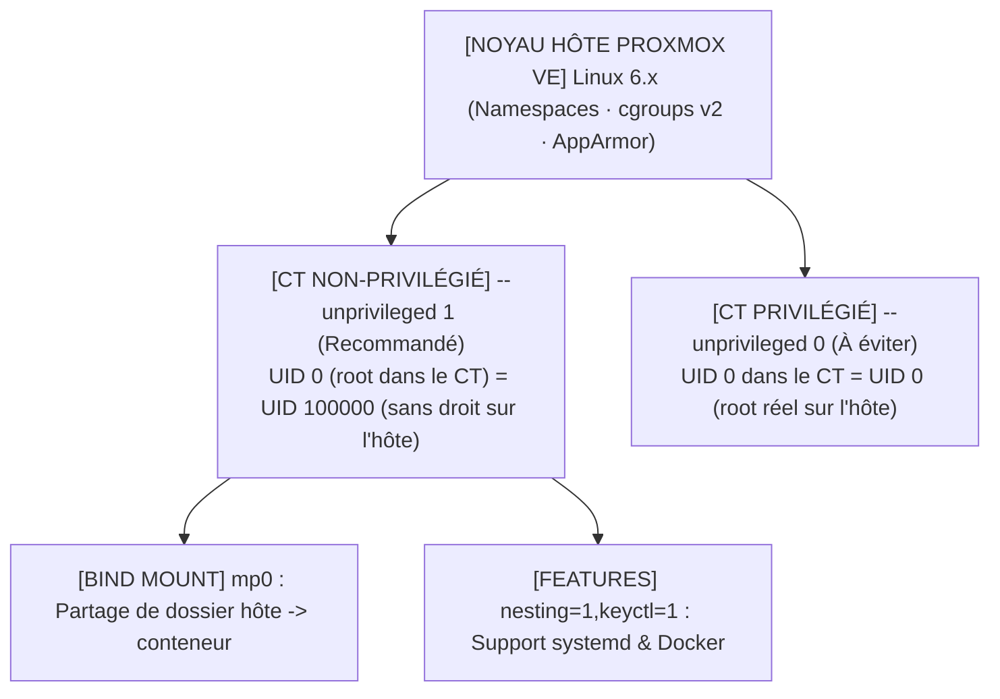

<!-- MASTER-HEADER-START -->
<div align="center">

<a href="https://0xcyberlitech.com/">
  
</a>

<p align="center">
  <a href="https://0xcyberlitech.com/"></a>
  <a href="https://0xcyberlitech.com/soc-rd.html"></a>
  <a href="https://0xcyberlitech.com/jarvis-rd.html"></a>
  <a href="https://github.com/0xCyberLiTech?tab=repositories"></a>
</p>
<p align="center">
  <a href="README.md"></a>
</p>


</div>
<!-- MASTER-HEADER-END -->

<!-- DEBIAN-TRUTH-START -->
> [!IMPORTANT]
>  ** Matrice Officielle Debian — `Debian 12 (Bookworm)` · `Debian 13 (Trixie)` · `Debian 14 (Forky)`**
> - **Sources Officielles Debian.org (`qemu`) :** `Bookworm (12)` : **`Stable-12`** &nbsp;·&nbsp; `Trixie (13 — Stable)` : **`Stable-13`** &nbsp;·&nbsp; `Forky (14 — Next-Gen)` : **`Testing-14`**
> - **Références Officielles :** [Paquet Debian Trixie (`qemu-system-x86`)](https://packages.debian.org/trixie/qemu-system-x86) &nbsp;·&nbsp; [Paquet Debian Forky (`qemu-system-x86`)](https://packages.debian.org/forky/qemu-system-x86) &nbsp;·&nbsp; [Documentation Officielle Debian](https://pve.proxmox.com/pve-docs/)
> - **Note d'Ingénierie (Divergence 13 vs 14) :** Depuis Proxmox VE 8 (Debian 12 Bookworm) et Proxmox VE 9 (Debian 13 Trixie / préparation Debian 14 Forky), les dépôts APT utilisent le format structuré **DEB822 (`/etc/apt/sources.list.d/pve-no-subscription.sources`)** et les mises à jour s'exécutent exclusivement via **`apt full-upgrade`**.

<details>
<summary> <b>Afficher les Encarts Ligne de Commande : Debian 13 (Trixie — Stable) vs Debian 14 (Forky — Next-Gen)</b></summary>

####  Profil Production Stable — Commandes pour `Debian 13 (Trixie)`
```bash
# Proxmox VE 9 (Debian 13 Trixie) — Depot officiel pve-no-subscription au format DEB822 (.sources) :
pveversion -v && pvesm status
apt update && apt full-upgrade -y
```

####  Profil Anticipation Next-Gen — Commandes pour `Debian 14 (Forky)`
```bash
# Debian 14 (Forky — Next-Gen) & Noyau Proxmox 6.14+ : Format DEB822 strict, ZFS 2.3+ & proxmox-boot-tool :
proxmox-boot-tool status && zpool status -x
qm list && pct list
```

</details>
<!-- DEBIAN-TRUTH-END -->

<!-- CIEL-PEDAGOGY-START -->
<details>
<summary> <b>Synthèse d'Architecture, Standards Officiels &amp; Diagnostic (Niveau 1 : Fondamentaux · Niveau 2 : Repères · Niveau 3 : Diagnostic)</b></summary>

- **Niveau 1 — Fondamentaux &amp; Principe d'Architecture :** **Proxmox Virtual Environment (Proxmox VE 8 & 9)** est un hyperviseur bare-metal de classe entreprise basé sur Debian combinant la virtualisation matérielle complète **KVM/QEMU (`qm`)**, les conteneurs système légers **LXC (`pct`)**, le stockage **ZFS / LVM-Thin (`pvesm`)**, la commutation réseau **Bridge/VLAN (`vmbr`)** et le pare-feu distribué **`pve-firewall`**.
- **Niveau 2 — Repères Officiels (Ports IANA, Fichiers Debian &amp; Commandes de Validation) :** **Ports Officiels :** `TCP 8006` (Web UI & API REST HTTPS) · `TCP 22` (SSH) · `TCP 5900-5999` (VNC) · `UDP 5405-5412` (Corosync Cluster) &nbsp;|&nbsp; **Fichiers clés :** `/etc/pve/` (`pmxcfs`), `/etc/network/interfaces`, `/etc/pve/storage.cfg` &nbsp;|&nbsp; **Validation officielle :** `pveversion -v && pvesm status && qm list && pct list`.
- **Niveau 3 — Diagnostic d'Incidents &amp; Ingénierie Avancée :** **Diagnostic & Architecture :** En cas de blocage de l'interface Web `:8006`, relancez `systemctl restart pveproxy pvedaemon pvestatd` (zéro coupure des VMs). Activez toujours l'`IPSet` réservé **`management`** avant d'activer `pve-firewall`, plafonnez l'ARC ZFS en RAM (`zfs_arc_max`), privilégiez les conteneurs LXC non-privilégiés (`unprivileged=1`) et validez vos sauvegardes `vzdump` (`.vma.zst` / `.tar.zst`) par un test de restauration isolé (`qmrestore --unique 1` avec `link_down=1`).
- **Sources de Vérité Officielles Éditeurs &amp; Standards :** [Documentation Officielle Proxmox VE (`pve-docs`)](https://pve.proxmox.com/pve-docs/) &nbsp;·&nbsp; [Wiki Officiel Proxmox VE](https://pve.proxmox.com/wiki/Main_Page) &nbsp;·&nbsp; [Documentation Proxmox Backup Server (PBS)](https://pbs.proxmox.com/docs/)
- **Livres Blancs &amp; 67 Podcasts Audio R&amp;D :** [Portail 0xCyberLiTech](https://0xcyberlitech.com/) &nbsp;·&nbsp; [Livre Blanc SOC Cockpit v5.5](https://0xcyberlitech.com/soc-rd.html) &nbsp;·&nbsp; [Livre Blanc JARVIS Mark-VII](https://0xcyberlitech.com/jarvis-rd.html) &nbsp;·&nbsp; [Blueprint Logiciel &amp; Matériel RTX 5080](https://0xcyberlitech.com/blueprint-jarvis.html)

</details>
<!-- CIEL-PEDAGOGY-END -->


#  Chapitre 05 — Conteneurs Linux LXC (`pct`) : Conteneurs Non-Privilégiés (`unprivileged`), Templates, Bind Mounts & Docker

##  01 // POURQUOI LES CONTENEURS LXC (`pct`) SONT UN ATOUT MAJEUR DE PROXMOX VE


Contrairement à une machine virtuelle KVM qui émule tout un matériel et lance son propre noyau Linux, un **conteneur LXC (*Linux Containers*)** partage directement le noyau de l'hôte Proxmox VE tout en isolant ses processus, son réseau et son système de fichiers via les **Namespaces** et les **cgroups v2**.

- **Démarrage instantané :** un conteneur Debian 13 démarre en **moins d'une seconde**.
- **Sobriété mémoire extrême :** à vide, un conteneur Debian ne consomme que **30 à 45 Mo de RAM** (contre 400 Mo+ pour une VM).
- **Redimensionnement à la volée :** l'ajout de cœurs CPU ou de RAM s'effectue **à chaud sans aucun redémarrage** du conteneur.



---

##  02 // RÈGLE DE SÉCURITÉ VITALE : TOUJOURS CRÉER DES CONTENEURS NON-PRIVILÉGIÉS (`unprivileged=1`)


> [!WARNING]
> **Différence entre Conteneur Non-Privilégié (`Unprivileged`) et Privilégié :**
> - Dans un **Conteneur Non-Privilégié (`--unprivileged 1`, coché par défaut)**, Proxmox décale tous les identifiants utilisateurs de `100 000` : l'utilisateur `root` (`UID 0`) à l'intérieur du conteneur correspond en réalité à l'utilisateur inoffensif **`UID 100000`** sur l'hôte Proxmox. Même en cas d'évasion du conteneur, l'attaquant n'a **aucun droit root** sur l'hyperviseur.
> - Dans un **Conteneur Privilégié (`--unprivileged 0`)**, `UID 0` dans le conteneur est le vrai `root` de l'hyperviseur. Ne créez **jamais** de conteneur privilégié pour un service exposé.

---

##  03 // TÉLÉCHARGER LES TEMPLATES OFFICIELS DEBIAN (`pveam`) ET CRÉER UN CONTENEUR (`pct create`)


La gestion des images de conteneurs (*Appliances*) s'effectue avec l'outil officiel **`pveam` (*Proxmox VE Appliance Manager*)** :

<!-- CODE-WINDOW-START -->
> [!CAUTION]
> 
>
> ```bash
> # 1. Mettre à jour le catalogue officiel des templates LXC Proxmox
> pveam update
>
> # 2. Rechercher les templates officiels Debian 12 (Bookworm) et Debian 13 (Trixie)
> pveam available --section system | grep debian
>
> # 3. Télécharger le template officiel Debian dans le stockage 'local'
> pveam download local debian-12-standard_12.7-1_amd64.tar.zst
>
> # 4. Vérifier les templates présents localement
> pveam list local
> ```
<!-- CODE-WINDOW-END -->

Création d'un conteneur LXC non-privilégié (`CT 109`) en une seule commande avec **`pct`** :

<!-- CODE-WINDOW-START -->
> [!CAUTION]
> 
>
> ```bash
> pct create 109 local:vztmpl/debian-12-standard_12.7-1_amd64.tar.zst \
>   --hostname srv-app-lxc \
>   --unprivileged 1 \
>   --features nesting=1 \
>   --cores 4 \
>   --memory 4096 \
>   --swap 512 \
>   --rootfs local-lvm:20 \
>   --net0 name=eth0,bridge=vmbr0,ip=192.0.2.109/24,gw=192.0.2.1,firewall=1 \
>   --nameserver 1.1.1.1 \
>   --ssh-public-keys ~/.ssh/authorized_keys \
>   --start 1
> ```
<!-- CODE-WINDOW-END -->

---

##  04 // PILOTER UN CONTENEUR AU QUOTIDIEN DEPUIS L'HÔTE (`pct enter`, `pct exec`, `pct push/pull`)


L'un des plus grands conforts de LXC est de pouvoir administrer un conteneur directement depuis l'hôte Proxmox **même si le réseau ou le service SSH du conteneur est coupé** :

<!-- CODE-WINDOW-START -->
> [!CAUTION]
> 
>
> ```bash
> # 1. Ouvrir immédiatement un shell root interactif dans le conteneur 109 (sans SSH)
> pct enter 109
>
> # 2. Exécuter une commande ponctuelle dans le conteneur 109 depuis l'hôte Proxmox
> pct exec 109 -- apt update
> pct exec 109 -- systemctl status ssh --no-pager
>
> # 3. Copier un fichier de l'hôte Proxmox vers le conteneur (push) ou l'inverse (pull)
> pct push 109 /root/config.yaml /etc/app/config.yaml
> pct pull 109 /var/log/syslog /tmp/syslog-ct109.log
>
> # 4. Modifier à chaud la RAM ou le nombre de cœurs CPU sans redémarrer le conteneur
> pct set 109 --memory 8192 --cores 6
> ```
<!-- CODE-WINDOW-END -->

---

##  05 // MONTER UN RÉPERTOIRE DE L'HÔTE OU DU NAS DANS UN CONTENEUR (`Bind Mount mp0`)


Pour partager un dossier massif de l'hôte Proxmox (par exemple un dataset ZFS `/zfs-data/partage`) avec un conteneur LXC **non-privilégié** :

> [!TIP]
> **Astuce des permissions UID `100000+` sur un Bind Mount :**
> Comme `UID 0` (root) dans le conteneur non-privilégié correspond à `UID 100000` sur l'hôte (et qu'un utilisateur `UID 1000` dans le conteneur correspond à `UID 101000` sur l'hôte), attribuez sur l'hôte Proxmox la propriété `100000:100000` au dossier partagé (ou utilisez la directive `idmap` de Proxmox VE 8/9).

<!-- CODE-WINDOW-START -->
> [!CAUTION]
> 
>
> ```bash
> # 1. Sur l'hôte Proxmox : créer le dossier et ajuster l'UID pour le root du conteneur non-privilégié
> mkdir -p /zfs-data/partage-ct109
> chown -R 100000:100000 /zfs-data/partage-ct109
>
> # 2. Attacher le point de montage mp0 au conteneur 109 (exclu des backups vzdump par défaut sauf si backup=1)
> pct set 109 -mp0 /zfs-data/partage-ct109,mp=/mnt/data,backup=0
>
> # 3. Vérifier à l'intérieur du conteneur que l'écriture fonctionne
> pct exec 109 -- touch /mnt/data/test_ok
> ```
<!-- CODE-WINDOW-END -->

---

##  06 // SOURCES DE VÉRITÉ OFFICIELLES & RÉFÉRENCES MANPAGES


- **Proxmox VE Administration Guide — Chapter 11 : Proxmox Container Toolkit (`pct`) :** `https://pve.proxmox.com/pve-docs/chapter-pct.html`
- **Proxmox VE Wiki — Unprivileged LXC Containers (`UID 100000+` & `idmap`) :** `https://pve.proxmox.com/wiki/Unprivileged_LXC_containers`
- **Proxmox VE Wiki — Linux Container (Bind Mount Points `mp0`) :** `https://pve.proxmox.com/wiki/Linux_Container#_bind_mount_points`
- **Pages de manuel système (Manpages) :** `man 1 pct`, `man 5 pct.conf`, `man 1 pveam`

<!-- MASTER-FOOTER-START -->
<div align="center">


<a href="https://0xcyberlitech.com/">
  
</a>

<p align="center"><a href="https://0xcyberlitech.com/"></a></p>

<sub><b>Architecturé &amp; Forgé par Marc &amp; Antigravity (Google DeepMind)</b> &nbsp;·&nbsp; <a href="https://0xcyberlitech.com/"><b>0xcyberlitech.com</b></a> &nbsp;·&nbsp; <a href="https://0xcyberlitech.com/soc-rd.html">Architecture SOC Cockpit v5.5</a> &nbsp;·&nbsp; <a href="https://0xcyberlitech.com/jarvis-rd.html">Architecture JARVIS Mark-VII</a> &nbsp;·&nbsp; <a href="https://0xcyberlitech.com/blueprint-jarvis.html">Blueprint Matériel RTX 5080</a></sub>

</div>
<!-- MASTER-FOOTER-END -->
