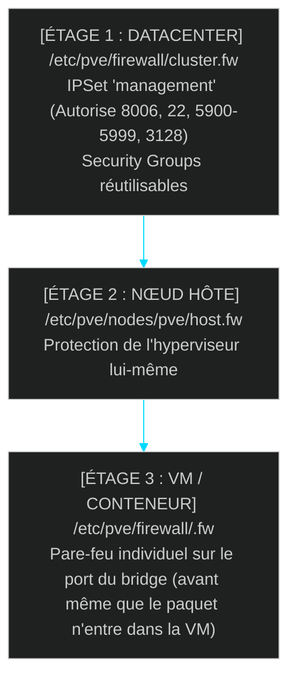

<!-- MASTER-HEADER-START -->
<div align="center">

<a href="https://0xcyberlitech.com/">
  
</a>

<p align="center">
  <a href="https://0xcyberlitech.com/"></a>
  <a href="https://0xcyberlitech.com/soc-rd.html"></a>
  <a href="https://0xcyberlitech.com/jarvis-rd.html"></a>
  <a href="https://github.com/0xCyberLiTech?tab=repositories"></a>
</p>
<p align="center">
  <a href="README.md"></a>
</p>


</div>
<!-- MASTER-HEADER-END -->

<!-- DEBIAN-TRUTH-START -->
> [!IMPORTANT]
>  ** Matrice Officielle Debian — `Debian 12 (Bookworm)` · `Debian 13 (Trixie)` · `Debian 14 (Forky)`**
> - **Sources Officielles Debian.org (`qemu`) :** `Bookworm (12)` : **`Stable-12`** &nbsp;·&nbsp; `Trixie (13 — Stable)` : **`Stable-13`** &nbsp;·&nbsp; `Forky (14 — Next-Gen)` : **`Testing-14`**
> - **Références Officielles :** [Paquet Debian Trixie (`qemu-system-x86`)](https://packages.debian.org/trixie/qemu-system-x86) &nbsp;·&nbsp; [Paquet Debian Forky (`qemu-system-x86`)](https://packages.debian.org/forky/qemu-system-x86) &nbsp;·&nbsp; [Documentation Officielle Debian](https://pve.proxmox.com/pve-docs/)
> - **Note d'Ingénierie (Divergence 13 vs 14) :** Depuis Proxmox VE 8 (Debian 12 Bookworm) et Proxmox VE 9 (Debian 13 Trixie / préparation Debian 14 Forky), les dépôts APT utilisent le format structuré **DEB822 (`/etc/apt/sources.list.d/pve-no-subscription.sources`)** et les mises à jour s'exécutent exclusivement via **`apt full-upgrade`**.

<details>
<summary> <b>Afficher les Encarts Ligne de Commande : Debian 13 (Trixie — Stable) vs Debian 14 (Forky — Next-Gen)</b></summary>

####  Profil Production Stable — Commandes pour `Debian 13 (Trixie)`
```bash
# Proxmox VE 9 (Debian 13 Trixie) — Depot officiel pve-no-subscription au format DEB822 (.sources) :
pveversion -v && pvesm status
apt update && apt full-upgrade -y
```

####  Profil Anticipation Next-Gen — Commandes pour `Debian 14 (Forky)`
```bash
# Debian 14 (Forky — Next-Gen) & Noyau Proxmox 6.14+ : Format DEB822 strict, ZFS 2.3+ & proxmox-boot-tool :
proxmox-boot-tool status && zpool status -x
qm list && pct list
```

</details>
<!-- DEBIAN-TRUTH-END -->

<!-- CIEL-PEDAGOGY-START -->
<details>
<summary> <b>Synthèse d'Architecture, Standards Officiels &amp; Diagnostic (Niveau 1 : Fondamentaux · Niveau 2 : Repères · Niveau 3 : Diagnostic)</b></summary>

- **Niveau 1 — Fondamentaux &amp; Principe d'Architecture :** **Proxmox Virtual Environment (Proxmox VE 8 & 9)** est un hyperviseur bare-metal de classe entreprise basé sur Debian combinant la virtualisation matérielle complète **KVM/QEMU (`qm`)**, les conteneurs système légers **LXC (`pct`)**, le stockage **ZFS / LVM-Thin (`pvesm`)**, la commutation réseau **Bridge/VLAN (`vmbr`)** et le pare-feu distribué **`pve-firewall`**.
- **Niveau 2 — Repères Officiels (Ports IANA, Fichiers Debian &amp; Commandes de Validation) :** **Ports Officiels :** `TCP 8006` (Web UI & API REST HTTPS) · `TCP 22` (SSH) · `TCP 5900-5999` (VNC) · `UDP 5405-5412` (Corosync Cluster) &nbsp;|&nbsp; **Fichiers clés :** `/etc/pve/` (`pmxcfs`), `/etc/network/interfaces`, `/etc/pve/storage.cfg` &nbsp;|&nbsp; **Validation officielle :** `pveversion -v && pvesm status && qm list && pct list`.
- **Niveau 3 — Diagnostic d'Incidents &amp; Ingénierie Avancée :** **Diagnostic & Architecture :** En cas de blocage de l'interface Web `:8006`, relancez `systemctl restart pveproxy pvedaemon pvestatd` (zéro coupure des VMs). Activez toujours l'`IPSet` réservé **`management`** avant d'activer `pve-firewall`, plafonnez l'ARC ZFS en RAM (`zfs_arc_max`), privilégiez les conteneurs LXC non-privilégiés (`unprivileged=1`) et validez vos sauvegardes `vzdump` (`.vma.zst` / `.tar.zst`) par un test de restauration isolé (`qmrestore --unique 1` avec `link_down=1`).
- **Sources de Vérité Officielles Éditeurs &amp; Standards :** [Documentation Officielle Proxmox VE (`pve-docs`)](https://pve.proxmox.com/pve-docs/) &nbsp;·&nbsp; [Wiki Officiel Proxmox VE](https://pve.proxmox.com/wiki/Main_Page) &nbsp;·&nbsp; [Documentation Proxmox Backup Server (PBS)](https://pbs.proxmox.com/docs/)
- **Livres Blancs &amp; 67 Podcasts Audio R&amp;D :** [Portail 0xCyberLiTech](https://0xcyberlitech.com/) &nbsp;·&nbsp; [Livre Blanc SOC Cockpit v5.5](https://0xcyberlitech.com/soc-rd.html) &nbsp;·&nbsp; [Livre Blanc JARVIS Mark-VII](https://0xcyberlitech.com/jarvis-rd.html) &nbsp;·&nbsp; [Blueprint Logiciel &amp; Matériel RTX 5080](https://0xcyberlitech.com/blueprint-jarvis.html)

</details>
<!-- CIEL-PEDAGOGY-END -->


#  Chapitre 06 — Sécurité & Durcissement Proxmox VE : Pare-feu à 3 Étages, `IPSet` Anti-Lockout, 2FA & Jetons API (`pveum`)

##  01 // COMPRENDRE L'ARCHITECTURE DU PARE-FEU `pve-firewall` (SANS JAMAIS SE BLOQUER DEHORS)


Beaucoup d'administrateurs n'osent pas activer le pare-feu intégré de Proxmox VE par peur de perdre immédiatement l'accès à l'interface Web (`TCP 8006`) et au SSH (`TCP 22`). Pourtant, `pve-firewall` possède un mécanisme natif de sécurité conçu spécifiquement pour éviter tout auto-bannissement : l'**`IPSet` réservé `management`**.



---

##  02 // RÈGLE D'OR AVANT D'ACTIVER LE PARE-FEU : CRÉER L'`IPSet` NOMMÉ `management`


> [!IMPORTANT]
> **Pourquoi le nom exact `management` est-il magique dans Proxmox VE ?**
> Selon la documentation officielle Proxmox VE, dès que vous créez au niveau **Datacenter → Firewall → IPSet** un ensemble nommé exactement **`management`** contenant le sous-réseau de votre poste d'administration (ex: `192.0.2.0/24`), Proxmox VE génère **automatiquement** une règle implicite autorisant ce réseau à accéder aux ports `8006` (GUI/API), `22` (SSH), `5900-5999` (Console VNC) et `3128` (SPICE), même si la politique d'entrée du Datacenter est réglée sur `DROP` !

###  Procédure sécurisée en 3 étapes (`/etc/pve/firewall/cluster.fw`)

<!-- CODE-WINDOW-START -->
> [!CAUTION]
> 
>
> ```ini
> [OPTIONS]
> # On prépare la configuration, enable=1 active le pare-feu globalement
> enable: 1
> policy_in: DROP
> policy_out: ACCEPT
>
> [IPSET management]
> # Sous-réseau LAN/Admin autorisé d'office sur 8006 et SSH
> 192.0.2.0/24 # Réseau d'administration
>
> [GROUP sg-web-public]
> # Groupe de sécurité réutilisable pour les VMs Web
> IN HTTP(ACCEPT) -log nolog
> IN HTTPS(ACCEPT) -log nolog
> ```
<!-- CODE-WINDOW-END -->

En cas de fausse manipulation en ligne de commande (via console physique ou IPMI/KVM), cette commande coupe instantanément le pare-feu Proxmox :

<!-- CODE-WINDOW-START -->
> [!CAUTION]
> 
>
> ```bash
> # Commande d'urgence pour stopper pve-firewall si vous avez fait une erreur de règle :
> pve-firewall stop
> ```
<!-- CODE-WINDOW-END -->

---

##  03 // AUTHENTIFICATION FORTE : ACTIVER LE 2FA (TOTP / YUBIKEY WEBAUTHN) ET DES CLÉS SSH `Ed25519`


L'interface Web `:8006` donne le contrôle total sur toutes vos machines virtuelles. Ne la laissez jamais protégée par un simple mot de passe :

1. **Dans l'interface Web Proxmox VE :** allez dans **Datacenter → Permissions → Two Factor → Add → TOTP** (application Authenticator) ou **WebAuthn** (clé matérielle FIDO2 / YubiKey).
2. **Générez systématiquement des Recovery Keys (Clés de secours à usage unique) :** cliquez sur **Add → Recovery Keys** et conservez-les dans votre coffre-fort hors-ligne.
3. **Côté SSH sur l'hôte Proxmox :** utilisez exclusivement une clé `Ed25519` et désactivez l'authentification par mot de passe dans un fichier dédié `/etc/ssh/sshd_config.d/99-proxmox-hardening.conf` :

<!-- CODE-WINDOW-START -->
> [!CAUTION]
> 
>
> ```bash
> cat > /etc/ssh/sshd_config.d/99-proxmox-hardening.conf <<'EOF'
> PermitRootLogin prohibit-password
> PasswordAuthentication no
> PubkeyAuthentication yes
> EOF
>
> sshd -t && systemctl reload ssh
> ```
<!-- CODE-WINDOW-END -->

---

##  04 // CRÉER UN JETON API (`API TOKEN`) EN LECTURE SEULE POUR LA SUPERVISION (`pveum`)


> [!WARNING]
> **N'inscrivez jamais le mot de passe de `root@pam` dans un outil tiers (Zabbix, Checkmk, Grafana, Home Assistant ou script de monitoring) !**
> Utilisez l'outil officiel **`pveum` (*Proxmox VE User Manager*)** pour créer un compte de service dédié et un **API Token avec séparation de privilèges (`--privsep 1`)** cantonné au rôle **`PVEAuditor`** (lecture seule stricte sur tout le serveur).

<!-- CODE-WINDOW-START -->
> [!CAUTION]
> 
>
> ```ini
> # 1. Créer un utilisateur de service dédié (realm 'pve', sans accès SSH système)
> pveum user add svc-monitor@pve --comment "Compte de supervision en lecture seule"
>
> # 2. Créer un API Token avec séparation de privilèges activée (--privsep 1)
> #    IMPORTANT : notez la valeur secrète affichée une seule fois à l'écran !
> pveum user token add svc-monitor@pve token-soc --privsep 1
>
> # 3. Attribuer le rôle lecture seule 'PVEAuditor' sur la racine '/' à l'utilisateur ET au token
> pveum acl modify / -user svc-monitor@pve -role PVEAuditor
> pveum acl modify / -token 'svc-monitor@pve!token-soc' -role PVEAuditor
>
> # 4. Tester le jeton API en direct avec curl (port 8006)
> curl -sk -H "Authorization: PVEAPIToken=svc-monitor@pve!token-soc=VOTRE_SECRET_UUID" \
>   https://127.0.0.1:8006/api2/json/nodes
> ```
<!-- CODE-WINDOW-END -->

Si vous avez besoin d'un second jeton autorisé uniquement à déclencher des sauvegardes ou gérer l'alimentation des VMs (sans toucher à l'hôte), utilisez les rôles granulaires **`PVEVMUser`** ou **`PVEDatastoreUser`** uniquement sur `/vms/<vmid>`.

---

##  05 // SOURCES DE VÉRITÉ OFFICIELLES & RÉFÉRENCES MANPAGES


- **Proxmox VE Administration Guide — Chapter 13 : Proxmox VE Firewall (`pve-firewall` & `IPSet management`) :** `https://pve.proxmox.com/pve-docs/chapter-pve-firewall.html`
- **Proxmox VE Administration Guide — Chapter 14 : User Management (`pveum`, 2FA TOTP/WebAuthn & API Tokens) :** `https://pve.proxmox.com/pve-docs/chapter-pveum.html`
- **Proxmox VE Wiki — Firewall :** `https://pve.proxmox.com/wiki/Firewall`
- **Pages de manuel système (Manpages) :** `man 8 pve-firewall`, `man 1 pveum`

<!-- MASTER-FOOTER-START -->
<div align="center">


<a href="https://0xcyberlitech.com/">
  
</a>

<p align="center"><a href="https://0xcyberlitech.com/"></a></p>

<sub><b>Architecturé &amp; Forgé par Marc &amp; Antigravity (Google DeepMind)</b> &nbsp;·&nbsp; <a href="https://0xcyberlitech.com/"><b>0xcyberlitech.com</b></a> &nbsp;·&nbsp; <a href="https://0xcyberlitech.com/soc-rd.html">Architecture SOC Cockpit v5.5</a> &nbsp;·&nbsp; <a href="https://0xcyberlitech.com/jarvis-rd.html">Architecture JARVIS Mark-VII</a> &nbsp;·&nbsp; <a href="https://0xcyberlitech.com/blueprint-jarvis.html">Blueprint Matériel RTX 5080</a></sub>

</div>
<!-- MASTER-FOOTER-END -->
