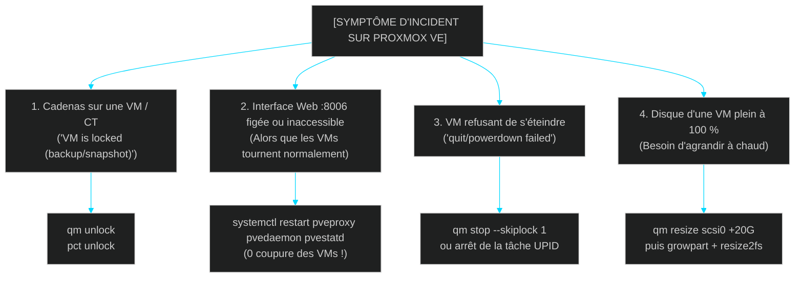

<!-- MASTER-HEADER-START -->
<div align="center">

<a href="https://0xcyberlitech.com/">
  
</a>

<p align="center">
  <a href="https://0xcyberlitech.com/"></a>
  <a href="https://0xcyberlitech.com/soc-rd.html"></a>
  <a href="https://0xcyberlitech.com/jarvis-rd.html"></a>
  <a href="https://github.com/0xCyberLiTech?tab=repositories"></a>
</p>
<p align="center">
  <a href="README.md"></a>
</p>


</div>
<!-- MASTER-HEADER-END -->

<!-- DEBIAN-TRUTH-START -->
> [!IMPORTANT]
>  ** Matrice Officielle Debian — `Debian 12 (Bookworm)` · `Debian 13 (Trixie)` · `Debian 14 (Forky)`**
> - **Sources Officielles Debian.org (`qemu`) :** `Bookworm (12)` : **`Stable-12`** &nbsp;·&nbsp; `Trixie (13 — Stable)` : **`Stable-13`** &nbsp;·&nbsp; `Forky (14 — Next-Gen)` : **`Testing-14`**
> - **Références Officielles :** [Paquet Debian Trixie (`qemu-system-x86`)](https://packages.debian.org/trixie/qemu-system-x86) &nbsp;·&nbsp; [Paquet Debian Forky (`qemu-system-x86`)](https://packages.debian.org/forky/qemu-system-x86) &nbsp;·&nbsp; [Documentation Officielle Debian](https://pve.proxmox.com/pve-docs/)
> - **Note d'Ingénierie (Divergence 13 vs 14) :** Depuis Proxmox VE 8 (Debian 12 Bookworm) et Proxmox VE 9 (Debian 13 Trixie / préparation Debian 14 Forky), les dépôts APT utilisent le format structuré **DEB822 (`/etc/apt/sources.list.d/pve-no-subscription.sources`)** et les mises à jour s'exécutent exclusivement via **`apt full-upgrade`**.

<details>
<summary> <b>Afficher les Encarts Ligne de Commande : Debian 13 (Trixie — Stable) vs Debian 14 (Forky — Next-Gen)</b></summary>

####  Profil Production Stable — Commandes pour `Debian 13 (Trixie)`
```bash
# Proxmox VE 9 (Debian 13 Trixie) — Depot officiel pve-no-subscription au format DEB822 (.sources) :
pveversion -v && pvesm status
apt update && apt full-upgrade -y
```

####  Profil Anticipation Next-Gen — Commandes pour `Debian 14 (Forky)`
```bash
# Debian 14 (Forky — Next-Gen) & Noyau Proxmox 6.14+ : Format DEB822 strict, ZFS 2.3+ & proxmox-boot-tool :
proxmox-boot-tool status && zpool status -x
qm list && pct list
```

</details>
<!-- DEBIAN-TRUTH-END -->

<!-- CIEL-PEDAGOGY-START -->
<details>
<summary> <b>Synthèse d'Architecture, Standards Officiels &amp; Diagnostic (Niveau 1 : Fondamentaux · Niveau 2 : Repères · Niveau 3 : Diagnostic)</b></summary>

- **Niveau 1 — Fondamentaux &amp; Principe d'Architecture :** **Proxmox Virtual Environment (Proxmox VE 8 & 9)** est un hyperviseur bare-metal de classe entreprise basé sur Debian combinant la virtualisation matérielle complète **KVM/QEMU (`qm`)**, les conteneurs système légers **LXC (`pct`)**, le stockage **ZFS / LVM-Thin (`pvesm`)**, la commutation réseau **Bridge/VLAN (`vmbr`)** et le pare-feu distribué **`pve-firewall`**.
- **Niveau 2 — Repères Officiels (Ports IANA, Fichiers Debian &amp; Commandes de Validation) :** **Ports Officiels :** `TCP 8006` (Web UI & API REST HTTPS) · `TCP 22` (SSH) · `TCP 5900-5999` (VNC) · `UDP 5405-5412` (Corosync Cluster) &nbsp;|&nbsp; **Fichiers clés :** `/etc/pve/` (`pmxcfs`), `/etc/network/interfaces`, `/etc/pve/storage.cfg` &nbsp;|&nbsp; **Validation officielle :** `pveversion -v && pvesm status && qm list && pct list`.
- **Niveau 3 — Diagnostic d'Incidents &amp; Ingénierie Avancée :** **Diagnostic & Architecture :** En cas de blocage de l'interface Web `:8006`, relancez `systemctl restart pveproxy pvedaemon pvestatd` (zéro coupure des VMs). Activez toujours l'`IPSet` réservé **`management`** avant d'activer `pve-firewall`, plafonnez l'ARC ZFS en RAM (`zfs_arc_max`), privilégiez les conteneurs LXC non-privilégiés (`unprivileged=1`) et validez vos sauvegardes `vzdump` (`.vma.zst` / `.tar.zst`) par un test de restauration isolé (`qmrestore --unique 1` avec `link_down=1`).
- **Sources de Vérité Officielles Éditeurs &amp; Standards :** [Documentation Officielle Proxmox VE (`pve-docs`)](https://pve.proxmox.com/pve-docs/) &nbsp;·&nbsp; [Wiki Officiel Proxmox VE](https://pve.proxmox.com/wiki/Main_Page) &nbsp;·&nbsp; [Documentation Proxmox Backup Server (PBS)](https://pbs.proxmox.com/docs/)

</details>
<!-- CIEL-PEDAGOGY-END -->


#  Chapitre 08 — Guide de Survie CLI, Scripts de Maintenance & Dépannage au Quotidien (`qm`, `pct`, `pvesm`, Verrous & Relance Web UI sans Coupure)

##  01 // LE MÉMENTO D'URGENCE QUAND PROXMOX VE SEMBLE BLOQUÉ


Au quotidien, 95 % des situations de blocage sur Proxmox VE se résolvent en moins de 30 secondes en ligne de commande SSH sans **jamais** avoir besoin de redémarrer le serveur physique :



---

##  02 // CAS N°1 : DÉBLOQUER UNE VM OU UN CONTENEUR VERROUILLÉ (`VM is locked`)


Lorsqu'une sauvegarde `vzdump`, un snapshot ou une migration est interrompue brutalement, Proxmox conserve un verrou de sécurité (`lock: backup` ou `lock: snapshot`) qui empêche de démarrer ou modifier la machine.

<!-- CODE-WINDOW-START -->
> [!CAUTION]
> 
>
> ```bash
> # 1. Vérifier d'abord qu'aucune tâche vzdump ne tourne réellement en arrière-plan :
> ps aux | grep -E 'vzdump|qemu|lxc'
>
> # 2. Lever proprement le verrou d'une VM KVM (ex: 101) :
> qm unlock 101
>
> # 3. Lever proprement le verrou d'un conteneur LXC (ex: 109) :
> pct unlock 109
>
> # 4. Si un fichier de verrouillage système orphelin subsiste :
> rm -f /var/lock/qemu-server/lock-101.conf
> ```
<!-- CODE-WINDOW-END -->

---

##  03 // CAS N°2 : RELANCER L'INTERFACE WEB (`:8006`) SANS COUPER AUCUNE VM EN PRODUCTION


> [!IMPORTANT]
> **Architecture découplée de Proxmox VE :**
> Dans Proxmox VE, chaque machine virtuelle KVM est un processus Linux autonome (`kvm -id <vmid>`). Vous pouvez redémarrer tous les démons de gestion Proxmox (`pveproxy`, `pvedaemon`, `pvestatd`, `pve-cluster`) **sans interrompre ni redémarrer aucune VM ni aucun conteneur en cours d'exécution** !

<!-- CODE-WINDOW-START -->
> [!CAUTION]
> 
>
> ```bash
> # Relancer l'interface Web (:8006), le démon API et le collecteur de métriques à chaud :
> systemctl restart pvedaemon pveproxy pvestatd
>
> # Vérifier que le port 8006 écoute de nouveau normalement :
> ss -tulpn | grep 8006
> systemctl status pveproxy pvedaemon pvestatd --no-pager
> ```
<!-- CODE-WINDOW-END -->

---

##  04 // CAS N°3 : FORCER L'ARRÊT D'UNE VM GELÉE QUI REFUSE DE S'ÉTEINDRE


Si une machine virtuelle a subi un *Kernel Panic* interne et ne répond plus au signal d'extinction ACPI (`qm shutdown`) :

<!-- CODE-WINDOW-START -->
> [!CAUTION]
> 
>
> ```bash
> # 1. Tenter un arrêt électrique immédiat (équivalent d'un appui long sur le bouton Power) :
> qm stop 101 --skiplock 1 --timeout 30
>
> # 2. Si une tâche d'arrêt précédente bloque encore la file, identifier son UPID :
> pvesh get /nodes/$(hostname)/tasks --running 1
>
> # 3. En dernier recours absolu, tuer le processus QEMU de la VM 101 par son fichier PID :
> kill -9 $(cat /var/run/qemu-server/101.pid)
> qm unlock 101
> ```
<!-- CODE-WINDOW-END -->

---

##  05 // CAS N°4 : AGRANDIR UN DISQUE À CHAUD SANS ÉTEINDRE LA VM (`qm resize`)


Lorsqu'une VM ou un conteneur manque d'espace disque, vous pouvez ajouter de l'espace **à chaud sans aucune interruption de service** :

###  A. Sur l'hôte Proxmox VE : agrandir le volume virtuel

<!-- CODE-WINDOW-START -->
> [!CAUTION]
> 
>
> ```bash
> # Ajouter 20 Go au disque scsi0 de la VM 101 (à chaud) :
> qm resize 101 scsi0 +20G
>
> # Ou ajouter 10 Go au disque rootfs du conteneur LXC 109 (redimensionne ext4 automatiquement !) :
> pct resize 109 rootfs +10G
> ```
<!-- CODE-WINDOW-END -->

###  B. À l'intérieur de la VM Debian : étendre la partition et le système de fichiers `ext4`

<!-- CODE-WINDOW-START -->
> [!CAUTION]
> 
>
> ```bash
> # Installer growpart (fourni par cloud-guest-utils) si absent :
> sudo apt update && sudo apt install -y cloud-guest-utils
>
> # Étendre la partition 1 du disque sda (notez l'espace entre /dev/sda et 1) puis le système de fichiers :
> sudo growpart /dev/sda 1
> sudo resize2fs /dev/sda1
>
> # Vérifier immédiatement le nouvel espace disponible :
> df -h /
> ```
<!-- CODE-WINDOW-END -->

---

##  06 // SCRIPT D'EXPLOITATION N°1 : SNAPSHOT DE SÉCURITÉ AUTOMATIQUE AVANT MAINTENANCE (`proxmox-pre-maintenance-snap.sh`)


Avant d'appliquer des mises à jour critiques dans vos VMs ou conteneurs, ce script prend automatiquement un snapshot horodaté sur toutes vos machines actives, et permet de les purger d'une seule commande une fois vos vérifications terminées :

<!-- CODE-WINDOW-START -->
> [!CAUTION]
> 
>
> ```bash
> #!/usr/bin/env bash
> # proxmox-pre-maintenance-snap.sh — Prise et purge automatisées de snapshots de pré-maintenance
> # Usage :
> #   Créer les snapshots : ./proxmox-pre-maintenance-snap.sh create "Avant maj mensuelle"
> #   Purger les snapshots : ./proxmox-pre-maintenance-snap.sh cleanup
> set -euo pipefail
>
> ACTION="${1:-create}"
> DESC="${2:-Snapshot automatique pre-maintenance}"
> SNAP_NAME="pre_maint_auto"
>
> if [ "$ACTION" = "create" ]; then
>   for vmid in $(qm list | awk 'NR>1 && $3=="running" {print $1}'); do
>     echo "[VM ${vmid}] Création du snapshot '${SNAP_NAME}'..."
>     qm snapshot "$vmid" "$SNAP_NAME" --description "$DESC"
>   done
>   for ctid in $(pct list | awk 'NR>1 && $2=="running" {print $1}'); do
>     echo "[CT ${ctid}] Création du snapshot '${SNAP_NAME}'..."
>     pct snapshot "$ctid" "$SNAP_NAME" --description "$DESC"
>   done
>   echo "[OK] Tous les snapshots '${SNAP_NAME}' sont en place."
>
> elif [ "$ACTION" = "cleanup" ]; then
>   for vmid in $(qm list | awk 'NR>1 {print $1}'); do
>     if qm listsnapshot "$vmid" | grep -q "$SNAP_NAME"; then
>       echo "[VM ${vmid}] Suppression du snapshot '${SNAP_NAME}'..."
>       qm delsnapshot "$vmid" "$SNAP_NAME"
>     fi
>   done
>   for ctid in $(pct list | awk 'NR>1 {print $1}'); do
>     if pct listsnapshot "$ctid" | grep -q "$SNAP_NAME"; then
>       echo "[CT ${ctid}] Suppression du snapshot '${SNAP_NAME}'..."
>       pct delsnapshot "$ctid" "$SNAP_NAME"
>     fi
>   done
>   echo "[OK] Purge des snapshots '${SNAP_NAME}' terminée."
> else
>   echo "Usage : $0 {create|cleanup} [description]" >&2
>   exit 1
> fi
> ```
<!-- CODE-WINDOW-END -->

---

##  07 // SCRIPT D'EXPLOITATION N°2 : DIAGNOSTIC DE SANTÉ COMPLET DU NŒUD (`proxmox-health-audit.sh`)


Ce script inspecte en une seconde l'état des démons Proxmox, le taux d'occupation des stockages, la santé ZFS, l'usure SMART des SSD/NVMe et la présence éventuelle de verrous orphelins :

<!-- CODE-WINDOW-START -->
> [!CAUTION]
> 
>
> ```bash
> #!/usr/bin/env bash
> # proxmox-health-audit.sh — Bilan de santé instantané d'un hyperviseur Proxmox VE
> set -euo pipefail
>
> echo "=== [1/5] VERSION & NOYAU PROXMOX VE ==="
> pveversion
> uname -r
>
> echo -e "\n=== [2/5] ÉTAT DES DÉMONS CRITIQUES PROXMOX ==="
> for svc in pve-cluster pvedaemon pveproxy pvestatd pve-firewall; do
>   printf "  - %-15s : %s\n" "$svc" "$(systemctl is-active "$svc" 2>/dev/null || echo inactive)"
> done
>
> echo -e "\n=== [3/5] ÉTAT DES STOCKAGES (pvesm status) ==="
> pvesm status
>
> if command -v zpool >/dev/null 2>&1 && zpool list >/dev/null 2>&1; then
>   echo -e "\n=== [4/5] SANTÉ DES POOLS ZFS ==="
>   zpool status -x
> fi
>
> echo -e "\n=== [5/5] DÉTECTION DES VERROUS ORPHELINS (lock:) ==="
> LOCKS=$(grep -rn "^lock:" /etc/pve/qemu-server/ /etc/pve/lxc/ 2>/dev/null || true)
> if [ -z "$LOCKS" ]; then
>   echo "  -> Aucun verrou actif détecté sur les VMs et conteneurs."
> else
>   echo "$LOCKS"
> fi
> ```
<!-- CODE-WINDOW-END -->

---

##  08 // TABLEAU RÉCAPITULATIF `/etc/pve/` & SOURCES DE VÉRITÉ OFFICIELLES


Le dossier **`/etc/pve/`** est un système de fichiers virtuel stocké dans une base SQLite en mémoire répliquée (**`pmxcfs`** — *Proxmox Cluster File System*) :

| Chemin dans `/etc/pve/` | Rôle Exact | Commande Associée |
|:---|:---|:---|
| `/etc/pve/qemu-server/<vmid>.conf` | Configuration matérielle de la VM `<vmid>` | `qm config <vmid>` |
| `/etc/pve/lxc/<ctid>.conf` | Configuration du conteneur LXC `<ctid>` | `pct config <ctid>` |
| `/etc/pve/storage.cfg` | Déclaration de tous les stockages (`local`, `zfs`, `nfs`, `pbs`) | `pvesm status` |
| `/etc/pve/user.cfg` | Utilisateurs, groupes, rôles et jetons API (`API Tokens`) | `pveum user list` |
| `/etc/pve/firewall/cluster.fw` | Règles pare-feu Datacenter, `IPSet` `management` & Security Groups | `pve-firewall status` |
| `/etc/pve/vzdump.cron` | Planification globale des sauvegardes automatiques | `cat /etc/pve/vzdump.cron` |

###  Sources de Vérité Officielles & Références Manpages

- **Proxmox VE Administration Guide — Command Line Interface (`qm`, `pct`, `pvesm`, `pvesh`) :** `https://pve.proxmox.com/pve-docs/pve-admin-guide.html`
- **Proxmox VE Administration Guide — Service Daemons (`pveproxy`, `pvedaemon`, `pvestatd`, `pmxcfs`) :** `https://pve.proxmox.com/pve-docs/chapter-sysadmin.html#_service_daemons`
- **Pages de manuel système (Manpages) :** `man 1 qm`, `man 1 pct`, `man 1 pvesm`, `man 1 pvesh`, `man 8 pveproxy`, `man 8 pvedaemon`

<!-- MASTER-FOOTER-START -->
<div align="center">


<a href="https://0xcyberlitech.com/">
  
</a>

<p align="center"><a href="https://0xcyberlitech.com/"></a></p>

<sub><b>Architecturé &amp; Forgé par Marc &amp; Antigravity (Google DeepMind)</b> &nbsp;·&nbsp; <a href="https://0xcyberlitech.com/"><b>0xcyberlitech.com</b></a> &nbsp;·&nbsp; <a href="https://0xcyberlitech.com/soc-rd.html">Architecture SOC Cockpit v5.5</a> &nbsp;·&nbsp; <a href="https://0xcyberlitech.com/jarvis-rd.html">Architecture JARVIS Mark-VII</a> &nbsp;·&nbsp; <a href="https://0xcyberlitech.com/blueprint-jarvis.html">Blueprint Matériel RTX 5080</a></sub>

</div>
<!-- MASTER-FOOTER-END -->
