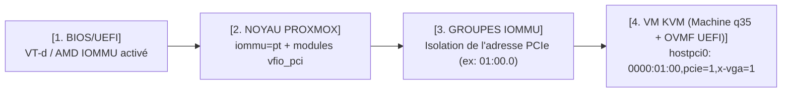

<!-- MASTER-HEADER-START -->
<div align="center">

<a href="https://0xcyberlitech.com/">
  
</a>

<p align="center">
  <a href="https://0xcyberlitech.com/"></a>
  <a href="https://0xcyberlitech.com/soc-rd.html"></a>
  <a href="https://0xcyberlitech.com/jarvis-rd.html"></a>
  <a href="https://github.com/0xCyberLiTech?tab=repositories"></a>
</p>
<p align="center">
  <a href="README.md"></a>
</p>


</div>
<!-- MASTER-HEADER-END -->

<!-- DEBIAN-TRUTH-START -->
> [!IMPORTANT]
>  ** Matrice Officielle Debian — `Debian 12 (Bookworm)` · `Debian 13 (Trixie)` · `Debian 14 (Forky)`**
> - **Sources Officielles Debian.org (`qemu`) :** `Bookworm (12)` : **`Stable-12`** &nbsp;·&nbsp; `Trixie (13 — Stable)` : **`Stable-13`** &nbsp;·&nbsp; `Forky (14 — Next-Gen)` : **`Testing-14`**
> - **Références Officielles :** [Paquet Debian Trixie (`qemu-system-x86`)](https://packages.debian.org/trixie/qemu-system-x86) &nbsp;·&nbsp; [Paquet Debian Forky (`qemu-system-x86`)](https://packages.debian.org/forky/qemu-system-x86) &nbsp;·&nbsp; [Documentation Officielle Debian](https://pve.proxmox.com/pve-docs/)
> - **Note d'Ingénierie (Divergence 13 vs 14) :** Depuis Proxmox VE 8 (Debian 12 Bookworm) et Proxmox VE 9 (Debian 13 Trixie / préparation Debian 14 Forky), les dépôts APT utilisent le format structuré **DEB822 (`/etc/apt/sources.list.d/pve-no-subscription.sources`)** et les mises à jour s'exécutent exclusivement via **`apt full-upgrade`**.

<details>
<summary> <b>Afficher les Encarts Ligne de Commande : Debian 13 (Trixie — Stable) vs Debian 14 (Forky — Next-Gen)</b></summary>

####  Profil Production Stable — Commandes pour `Debian 13 (Trixie)`
```bash
# Proxmox VE 9 (Debian 13 Trixie) — Depot officiel pve-no-subscription au format DEB822 (.sources) :
pveversion -v && pvesm status
apt update && apt full-upgrade -y
```

####  Profil Anticipation Next-Gen — Commandes pour `Debian 14 (Forky)`
```bash
# Debian 14 (Forky — Next-Gen) & Noyau Proxmox 6.14+ : Format DEB822 strict, ZFS 2.3+ & proxmox-boot-tool :
proxmox-boot-tool status && zpool status -x
qm list && pct list
```

</details>
<!-- DEBIAN-TRUTH-END -->

<!-- CIEL-PEDAGOGY-START -->
<details>
<summary> <b>Synthèse d'Architecture, Standards Officiels &amp; Diagnostic (Niveau 1 : Fondamentaux · Niveau 2 : Repères · Niveau 3 : Diagnostic)</b></summary>

- **Niveau 1 — Fondamentaux &amp; Principe d'Architecture :** **Proxmox Virtual Environment (Proxmox VE 8 & 9)** est un hyperviseur bare-metal de classe entreprise basé sur Debian combinant la virtualisation matérielle complète **KVM/QEMU (`qm`)**, les conteneurs système légers **LXC (`pct`)**, le stockage **ZFS / LVM-Thin (`pvesm`)**, la commutation réseau **Bridge/VLAN (`vmbr`)** et le pare-feu distribué **`pve-firewall`**.
- **Niveau 2 — Repères Officiels (Ports IANA, Fichiers Debian &amp; Commandes de Validation) :** **Ports Officiels :** `TCP 8006` (Web UI & API REST HTTPS) · `TCP 22` (SSH) · `TCP 5900-5999` (VNC) · `UDP 5405-5412` (Corosync Cluster) &nbsp;|&nbsp; **Fichiers clés :** `/etc/pve/` (`pmxcfs`), `/etc/network/interfaces`, `/etc/pve/storage.cfg` &nbsp;|&nbsp; **Validation officielle :** `pveversion -v && pvesm status && qm list && pct list`.
- **Niveau 3 — Diagnostic d'Incidents &amp; Ingénierie Avancée :** **Diagnostic & Architecture :** En cas de blocage de l'interface Web `:8006`, relancez `systemctl restart pveproxy pvedaemon pvestatd` (zéro coupure des VMs). Activez toujours l'`IPSet` réservé **`management`** avant d'activer `pve-firewall`, plafonnez l'ARC ZFS en RAM (`zfs_arc_max`), privilégiez les conteneurs LXC non-privilégiés (`unprivileged=1`) et validez vos sauvegardes `vzdump` (`.vma.zst` / `.tar.zst`) par un test de restauration isolé (`qmrestore --unique 1` avec `link_down=1`).
- **Sources de Vérité Officielles Éditeurs &amp; Standards :** [Documentation Officielle Proxmox VE (`pve-docs`)](https://pve.proxmox.com/pve-docs/) &nbsp;·&nbsp; [Wiki Officiel Proxmox VE](https://pve.proxmox.com/wiki/Main_Page) &nbsp;·&nbsp; [Documentation Proxmox Backup Server (PBS)](https://pbs.proxmox.com/docs/)
- **Livres Blancs &amp; 67 Podcasts Audio R&amp;D :** [Portail 0xCyberLiTech](https://0xcyberlitech.com/) &nbsp;·&nbsp; [Livre Blanc SOC Cockpit v5.5](https://0xcyberlitech.com/soc-rd.html) &nbsp;·&nbsp; [Livre Blanc JARVIS Mark-VII](https://0xcyberlitech.com/jarvis-rd.html) &nbsp;·&nbsp; [Blueprint Logiciel &amp; Matériel RTX 5080](https://0xcyberlitech.com/blueprint-jarvis.html)

</details>
<!-- CIEL-PEDAGOGY-END -->


#  Chapitre 09 — Fonctions Avancées : PCIe / GPU Passthrough (IOMMU / VFIO), Cluster Multi-Nœuds (`pvecm`) & Quorum

##  01 // DÉDIER UNE CARTE GRAPHIQUE (GPU) OU UNE CARTE RÉSEAU 10G À UNE VM (`PCIe Passthrough`)


Le **PCIe Passthrough (`VFIO`)** permet de détacher un périphérique matériel physique (une carte graphique NVIDIA RTX / AMD, un contrôleur HBA SATA/NVMe ou une carte réseau 10G SFP+) de l'hôte Proxmox VE pour le confier en **accès matériel direct (sans aucune couche d'émulation)** à une machine virtuelle KVM.



---

##  02 // ACTIVER L'IOMMU ET LES MODULES `vfio` SUR L'HÔTE PROXMOX VE


###  A. Vérifier si votre serveur démarre via `GRUB` ou `systemd-boot` (ZFS UEFI)

<!-- CODE-WINDOW-START -->
> [!CAUTION]
> 
>
> ```bash
> # Si cette commande affiche des entrées, vous utilisez systemd-boot (/etc/kernel/cmdline) ;
> # sinon, vous utilisez GRUB (/etc/default/grub) :
> efibootmgr -v
> ```
<!-- CODE-WINDOW-END -->

- **Sur processeur Intel :** ajoutez `intel_iommu=on iommu=pt`
- **Sur processeur AMD :** ajoutez `amd_iommu=on iommu=pt` *(sur les noyaux Linux 6.x de Proxmox VE 8/9, AMD IOMMU est déjà actif par défaut si activé dans le BIOS ; `iommu=pt` optimise les performances des périphériques non-passthrough)*.

<!-- CODE-WINDOW-START -->
> [!CAUTION]
> 
>
> ```bash
> # Cas A : Si vous utilisez GRUB (/etc/default/grub)
> sed -i 's/GRUB_CMDLINE_LINUX_DEFAULT="quiet"/GRUB_CMDLINE_LINUX_DEFAULT="quiet intel_iommu=on iommu=pt"/' /etc/default/grub
> update-grub
>
> # Cas B : Si vous utilisez systemd-boot (Installation ZFS en mode UEFI)
> # Ajoutez intel_iommu=on iommu=pt à la fin de la ligne unique dans /etc/kernel/cmdline, puis :
> proxmox-boot-tool refresh
> ```
<!-- CODE-WINDOW-END -->

###  B. Charger les modules noyau `vfio` au démarrage

*(Note : depuis le noyau Linux 6.2+ embarqué dans Proxmox VE 8 et 9, l'ancien module `vfio_virqfd` est directement fusionné au sein du module principal `vfio`.)*

<!-- CODE-WINDOW-START -->
> [!CAUTION]
> 
>
> ```bash
> cat >> /etc/modules <<'EOF'
> vfio
> vfio_iommu_type1
> vfio_pci
> EOF
>
> update-initramfs -u -k all
> ```
<!-- CODE-WINDOW-END -->

Après redémarrage de l'hôte, vérifiez que l'isolation IOMMU est bien fonctionnelle et identifiez l'adresse PCIe de votre carte :

<!-- CODE-WINDOW-START -->
> [!CAUTION]
> 
>
> ```bash
> # 1. Vérifier que la séparation en groupes IOMMU est active
> dmesg | grep -e DMAR -e IOMMU -e AMD-Vi
> pvesh get /nodes/$(hostname)/hardware/pci --pci-class-blacklist ""
>
> # 2. Attacher la carte PCIe (ex: 0000:01:00) à une VM utilisant le chipset 'q35' et le BIOS UEFI 'ovmf'
> qm set 105 --machine q35 --bios ovmf
> qm set 105 --hostpci0 0000:01:00,pcie=1
> ```
<!-- CODE-WINDOW-END -->

---

##  03 // CLUSTER MULTI-NŒUDS (`pvecm`) : LA RÈGLE IMPÉRATIVE DU QUORUM (3 NŒUDS OU `QDevice`)


Lorsque vous reliez plusieurs serveurs Proxmox VE en un **Cluster (`pvecm`)**, ils synchronisent en temps réel leurs fichiers `/etc/pve/` via Corosync.

> [!WARNING]
> **Le piège classique du Cluster à 2 nœuds :**
> Pour éviter le scénario *Split-Brain* (deux serveurs modifiant `/etc/pve/` chacun de leur côté), un cluster Proxmox VE exige une **majorité stricte (`> 50 %` des voix = Quorum)**.
> - Avec **3 nœuds**, si 1 serveur s'éteint, il reste `2/3` des voix (`66 %`) : le cluster continue de fonctionner.
> - Avec **2 nœuds seulement**, si 1 serveur s'éteint, il ne reste que `1/2` (`50 %`, pas de majorité) : **le nœud survivant bloque toute modification et refuse de démarrer de nouvelles VMs !**
> - **Solution officielle si vous n'avez que 2 serveurs :** installez le paquet léger `corosync-qnetd` (**`QDevice`**) sur un petit conteneur externe ou un NAS pour apporter la **3e voix d'arbitrage** (`pvecm qdevice setup <IP_QDEVICE>`).

###  Commandes essentielles de gestion de Cluster (`pvecm`)

<!-- CODE-WINDOW-START -->
> [!CAUTION]
> 
>
> ```bash
> # 1. Sur le nœud maître (Node 1) : initialiser le cluster
> pvecm create cluster-prod
>
> # 2. Sur le nœud secondaire (Node 2, vierge de toute VM) : rejoindre le cluster
> pvecm add 192.0.2.20
>
> # 3. Vérifier l'état du cluster, des nœuds et du Quorum Corosync
> pvecm status
> pvecm nodes
> ```
<!-- CODE-WINDOW-END -->

---

##  04 // DÉPANNAGE D'URGENCE : DÉBLOQUER UN NŒUD ISOLÉ QUAND LE QUORUM EST PERDU (`pvecm expected 1`)


Si vous avez monté un cluster et que les autres nœuds sont éteints (maintenance, panne ou déménagement), votre nœud restant passe `/etc/pve/` en lecture seule et refuse de démarrer vos VMs avec l'erreur **`Cluster not quorate`**.

Voici la commande officielle de secours pour **forcer temporairement le quorum à 1 seule voix** et reprendre immédiatement le contrôle de vos VMs :

<!-- CODE-WINDOW-START -->
> [!CAUTION]
> 
>
> ```bash
> # Forcer le nombre de voix attendues à 1 sur le nœud survivant :
> pvecm expected 1
>
> # Vérifier que le statut 'Quorate' est repassé à 'Yes' :
> pvecm status
> ```
<!-- CODE-WINDOW-END -->

---

##  05 // SOURCES DE VÉRITÉ OFFICIELLES & RÉFÉRENCES MANPAGES


- **Proxmox VE Administration Guide — Section 10.9 : PCI(e) Passthrough (`IOMMU` / `VFIO`) :** `https://pve.proxmox.com/pve-docs/chapter-qm.html#qm_pci_passthrough`
- **Proxmox VE Wiki — PCI Passthrough & GPU Passthrough :** `https://pve.proxmox.com/wiki/PCI_Passthrough`
- **Proxmox VE Administration Guide — Chapter 5 : Cluster Manager (`pvecm`, Corosync & `QDevice`) :** `https://pve.proxmox.com/pve-docs/chapter-pvecm.html`
- **Proxmox VE Administration Guide — Chapter 15 : High Availability (`ha-manager`) :** `https://pve.proxmox.com/pve-docs/chapter-ha-manager.html`
- **Pages de manuel système (Manpages) :** `man 1 pvecm`, `man 8 proxmox-boot-tool`, `man 1 ha-manager`

<!-- MASTER-FOOTER-START -->
<div align="center">


<a href="https://0xcyberlitech.com/">
  
</a>

<p align="center"><a href="https://0xcyberlitech.com/"></a></p>

<sub><b>Architecturé &amp; Forgé par Marc &amp; Antigravity (Google DeepMind)</b> &nbsp;·&nbsp; <a href="https://0xcyberlitech.com/"><b>0xcyberlitech.com</b></a> &nbsp;·&nbsp; <a href="https://0xcyberlitech.com/soc-rd.html">Architecture SOC Cockpit v5.5</a> &nbsp;·&nbsp; <a href="https://0xcyberlitech.com/jarvis-rd.html">Architecture JARVIS Mark-VII</a> &nbsp;·&nbsp; <a href="https://0xcyberlitech.com/blueprint-jarvis.html">Blueprint Matériel RTX 5080</a></sub>

</div>
<!-- MASTER-FOOTER-END -->
