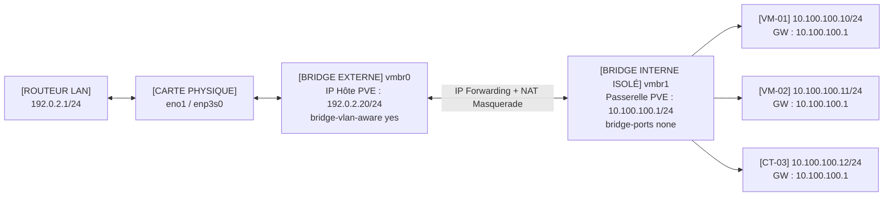

<!-- MASTER-HEADER-START -->
<div align="center">

<a href="https://0xcyberlitech.com/">
  
</a>

<p align="center">
  <a href="https://0xcyberlitech.com/"></a>
  <a href="https://0xcyberlitech.com/soc-rd.html"></a>
  <a href="https://0xcyberlitech.com/jarvis-rd.html"></a>
  <a href="https://github.com/0xCyberLiTech?tab=repositories"></a>
</p>
<p align="center">
  <a href="README.md"></a>
</p>


</div>
<!-- MASTER-HEADER-END -->

<!-- DEBIAN-TRUTH-START -->
> [!IMPORTANT]
>  ** Matrice Officielle Debian — `Debian 12 (Bookworm)` · `Debian 13 (Trixie)` · `Debian 14 (Forky)`**
> - **Sources Officielles Debian.org (`qemu`) :** `Bookworm (12)` : **`Stable-12`** &nbsp;·&nbsp; `Trixie (13 — Stable)` : **`Stable-13`** &nbsp;·&nbsp; `Forky (14 — Next-Gen)` : **`Testing-14`**
> - **Références Officielles :** [Paquet Debian Trixie (`qemu-system-x86`)](https://packages.debian.org/trixie/qemu-system-x86) &nbsp;·&nbsp; [Paquet Debian Forky (`qemu-system-x86`)](https://packages.debian.org/forky/qemu-system-x86) &nbsp;·&nbsp; [Documentation Officielle Debian](https://pve.proxmox.com/pve-docs/)
> - **Note d'Ingénierie (Divergence 13 vs 14) :** Depuis Proxmox VE 8 (Debian 12 Bookworm) et Proxmox VE 9 (Debian 13 Trixie / préparation Debian 14 Forky), les dépôts APT utilisent le format structuré **DEB822 (`/etc/apt/sources.list.d/pve-no-subscription.sources`)** et les mises à jour s'exécutent exclusivement via **`apt full-upgrade`**.

<details>
<summary> <b>Afficher les Encarts Ligne de Commande : Debian 13 (Trixie — Stable) vs Debian 14 (Forky — Next-Gen)</b></summary>

####  Profil Production Stable — Commandes pour `Debian 13 (Trixie)`
```bash
# Proxmox VE 9 (Debian 13 Trixie) — Depot officiel pve-no-subscription au format DEB822 (.sources) :
pveversion -v && pvesm status
apt update && apt full-upgrade -y
```

####  Profil Anticipation Next-Gen — Commandes pour `Debian 14 (Forky)`
```bash
# Debian 14 (Forky — Next-Gen) & Noyau Proxmox 6.14+ : Format DEB822 strict, ZFS 2.3+ & proxmox-boot-tool :
proxmox-boot-tool status && zpool status -x
qm list && pct list
```

</details>
<!-- DEBIAN-TRUTH-END -->

<!-- CIEL-PEDAGOGY-START -->
<details>
<summary> <b>Synthèse d'Architecture, Standards Officiels &amp; Diagnostic (Niveau 1 : Fondamentaux · Niveau 2 : Repères · Niveau 3 : Diagnostic)</b></summary>

- **Niveau 1 — Fondamentaux &amp; Principe d'Architecture :** **Proxmox Virtual Environment (Proxmox VE 8 & 9)** est un hyperviseur bare-metal de classe entreprise basé sur Debian combinant la virtualisation matérielle complète **KVM/QEMU (`qm`)**, les conteneurs système légers **LXC (`pct`)**, le stockage **ZFS / LVM-Thin (`pvesm`)**, la commutation réseau **Bridge/VLAN (`vmbr`)** et le pare-feu distribué **`pve-firewall`**.
- **Niveau 2 — Repères Officiels (Ports IANA, Fichiers Debian &amp; Commandes de Validation) :** **Ports Officiels :** `TCP 8006` (Web UI & API REST HTTPS) · `TCP 22` (SSH) · `TCP 5900-5999` (VNC) · `UDP 5405-5412` (Corosync Cluster) &nbsp;|&nbsp; **Fichiers clés :** `/etc/pve/` (`pmxcfs`), `/etc/network/interfaces`, `/etc/pve/storage.cfg` &nbsp;|&nbsp; **Validation officielle :** `pveversion -v && pvesm status && qm list && pct list`.
- **Niveau 3 — Diagnostic d'Incidents &amp; Ingénierie Avancée :** **Diagnostic & Architecture :** En cas de blocage de l'interface Web `:8006`, relancez `systemctl restart pveproxy pvedaemon pvestatd` (zéro coupure des VMs). Activez toujours l'`IPSet` réservé **`management`** avant d'activer `pve-firewall`, plafonnez l'ARC ZFS en RAM (`zfs_arc_max`), privilégiez les conteneurs LXC non-privilégiés (`unprivileged=1`) et validez vos sauvegardes `vzdump` (`.vma.zst` / `.tar.zst`) par un test de restauration isolé (`qmrestore --unique 1` avec `link_down=1`).
- **Sources de Vérité Officielles Éditeurs &amp; Standards :** [Documentation Officielle Proxmox VE (`pve-docs`)](https://pve.proxmox.com/pve-docs/) &nbsp;·&nbsp; [Wiki Officiel Proxmox VE](https://pve.proxmox.com/wiki/Main_Page) &nbsp;·&nbsp; [Documentation Proxmox Backup Server (PBS)](https://pbs.proxmox.com/docs/)
- **Livres Blancs &amp; 67 Podcasts Audio R&amp;D :** [Portail 0xCyberLiTech](https://0xcyberlitech.com/) &nbsp;·&nbsp; [Livre Blanc SOC Cockpit v5.5](https://0xcyberlitech.com/soc-rd.html) &nbsp;·&nbsp; [Livre Blanc JARVIS Mark-VII](https://0xcyberlitech.com/jarvis-rd.html) &nbsp;·&nbsp; [Blueprint Logiciel &amp; Matériel RTX 5080](https://0xcyberlitech.com/blueprint-jarvis.html)

</details>
<!-- CIEL-PEDAGOGY-END -->


#  Chapitre 03 — Architecture Réseau Proxmox VE : Bridges (`vmbr0`, `vmbr1`), VLANs 802.1Q, Routage NAT/Nftables & Rollback

##  01 // COMPRENDRE LA COMMUTATION RÉSEAU DANS PROXMOX VE (`vmbr0` vs `vmbr1`)


Dans Proxmox VE, chaque pont Linux (**`vmbrX`**) agit exactement comme un **switch Ethernet virtuel** intégré au noyau Debian de l'hyperviseur :

- **`vmbr0` (Bridge Externe / LAN) :** Il est relié physiquement (`bridge-ports eno1`) à votre carte réseau et à votre routeur. Toute VM branchée sur `vmbr0` se comporte comme une machine physique branchée directement sur votre switch.
- **`vmbr1` (Bridge Interne Isolé / DMZ / Lab) :** Il n'est relié à aucune carte physique (`bridge-ports none`). Les VMs branchées sur `vmbr1` communiquent entre elles dans une bulle étanche (`10.100.100.0/24`) et utilisent l'hôte Proxmox (`10.100.100.1`) comme passerelle NAT pour sortir vers Internet.



---

##  02 // DÉCLARER UN BRIDGE INTERNE (`vmbr1`) ET LE SUPPORT VLAN DANS `/etc/network/interfaces`


> [!TIP]
> **Rechargement réseau à chaud sans coupure grâce à `ifupdown2` :**
> Proxmox VE embarque par défaut le paquet `ifupdown2`. Contrairement à `systemctl restart networking` (qui coupe les sessions SSH et déconnecte temporairement les VMs), la commande **`ifreload -a`** calcule uniquement le différentiel et applique les modifications réseau **à chaud sans aucune coupure**.

Voici une configuration `/etc/network/interfaces` propre combinant `vmbr0` (avec support des VLANs 802.1Q `bridge-vlan-aware yes`) et un réseau interne isolé `vmbr1` en `10.100.100.0/24` :

<!-- CODE-WINDOW-START -->
> [!CAUTION]
> 
>
> ```ini
> auto lo
> iface lo inet loopback
>
> iface eno1 inet manual
>
> # vmbr0 — Bridge principal relié au LAN physique (avec support VLAN 802.1Q)
> auto vmbr0
> iface vmbr0 inet static
>     address 192.0.2.20/24
>     gateway 192.0.2.1
>     bridge-ports eno1
>     bridge-stp off
>     bridge-fd 0
>     bridge-vlan-aware yes
>     bridge-vids 2-4094
>
> # vmbr1 — Bridge interne isolé pour VMs / DMZ (10.100.100.0/24)
> auto vmbr1
> iface vmbr1 inet static
>     address 10.100.100.1/24
>     bridge-ports none
>     bridge-stp off
>     bridge-fd 0
> ```
<!-- CODE-WINDOW-END -->

Appliquez la configuration à chaud :

<!-- CODE-WINDOW-START -->
> [!CAUTION]
> 
>
> ```bash
> # Vérifier la syntaxe puis appliquer sans coupure
> ifreload -a
>
> # Contrôler que vmbr1 porte bien l'adresse 10.100.100.1/24
> ip -c addr show dev vmbr1
> ```
<!-- CODE-WINDOW-END -->

---

##  03 // ACTIVER LE ROUTAGE IPv4 ET LE NAT (`MASQUERADE`) POUR LES VMS DE `vmbr1`


Pour permettre aux machines branchées sur `vmbr1` (`10.100.100.0/24`) d'accéder à Internet (mises à jour APT) via `vmbr0` tout en restant isolées de votre réseau principal :

<!-- CODE-WINDOW-START -->
> [!CAUTION]
> 
>
> ```bash
> # 1. Activer le routage IPv4 du noyau immédiatement et de façon persistante
> cat > /etc/sysctl.d/99-proxmox-ipforward.conf <<'EOF'
> net.ipv4.ip_forward=1
> EOF
> sysctl --system
>
> # 2. Ajouter les règles NAT (POSTROUTING MASQUERADE) et de transfert (FORWARD)
> iptables -t nat -A POSTROUTING -s 10.100.100.0/24 -o vmbr0 -j MASQUERADE
> iptables -A FORWARD -i vmbr0 -o vmbr1 -m conntrack --ctstate RELATED,ESTABLISHED -j ACCEPT
> iptables -A FORWARD -i vmbr1 -o vmbr0 -j ACCEPT
>
> # 3. Rendre les règles persistantes au redémarrage
> apt update && apt install -y iptables-persistent
> netfilter-persistent save
> ```
<!-- CODE-WINDOW-END -->

Dans vos VMs ou conteneurs LXC attachés à `vmbr1`, configurez :
- **Adresse IP :** `10.100.100.10/24` (ou `.11`, `.12`...)
- **Passerelle (Gateway) :** `10.100.100.1` (l'IP de l'hôte Proxmox sur `vmbr1`)
- **Serveurs DNS :** `1.1.1.1`, `9.9.9.9`

---

##  04 // SCRIPT D'INSTALLATION AUTOMATIQUE IDEMPOTENT (`setup_vmbr1_nat.sh`)


Ce script sauvegarde `/etc/network/interfaces`, crée `vmbr1` s'il est absent, active `ip_forward`, applique les règles NAT de manière idempotente (sans doublon) et les persiste :

<!-- CODE-WINDOW-START -->
> [!CAUTION]
> 
>
> ```bash
> #!/usr/bin/env bash
> set -euo pipefail
>
> INTERNAL_NET="10.100.100.0/24"
> INTERNAL_GW="10.100.100.1/24"
> BR_INTERNAL="vmbr1"
> BR_EXTERNAL="vmbr0"
> INTERFACES_FILE="/etc/network/interfaces"
> BACKUP_DIR="/root/interfaces-backups"
> SYSCTL_CONF="/etc/sysctl.d/99-proxmox-vmbr1.conf"
>
> if [ "$(id -u)" -ne 0 ]; then
>   echo "Exécutez ce script en root." >&2
>   exit 1
> fi
>
> mkdir -p "$BACKUP_DIR"
> cp -a "$INTERFACES_FILE" "$BACKUP_DIR/interfaces.$(date +%s)"
>
> if ! grep -q "iface ${BR_INTERNAL} inet" "$INTERFACES_FILE"; then
>   cat >> "$INTERFACES_FILE" <<EOF
>
> # ${BR_INTERNAL} - Réseau interne isolé pour VMs
> auto ${BR_INTERNAL}
> iface ${BR_INTERNAL} inet static
>     address ${INTERNAL_GW}
>     bridge-ports none
>     bridge-stp off
>     bridge-fd 0
> EOF
> fi
>
> ifreload -a
>
> cat > "${SYSCTL_CONF}" <<EOF
> net.ipv4.ip_forward=1
> EOF
> sysctl --system
>
> iptables -t nat -C POSTROUTING -s "${INTERNAL_NET}" -o "${BR_EXTERNAL}" -j MASQUERADE 2>/dev/null || \
> iptables -t nat -A POSTROUTING -s "${INTERNAL_NET}" -o "${BR_EXTERNAL}" -j MASQUERADE
>
> iptables -C FORWARD -i "${BR_EXTERNAL}" -o "${BR_INTERNAL}" -m conntrack --ctstate RELATED,ESTABLISHED -j ACCEPT 2>/dev/null || \
> iptables -A FORWARD -i "${BR_EXTERNAL}" -o "${BR_INTERNAL}" -m conntrack --ctstate RELATED,ESTABLISHED -j ACCEPT
>
> iptables -C FORWARD -i "${BR_INTERNAL}" -o "${BR_EXTERNAL}" -j ACCEPT 2>/dev/null || \
> iptables -A FORWARD -i "${BR_INTERNAL}" -o "${BR_EXTERNAL}" -j ACCEPT
>
> export DEBIAN_FRONTEND=noninteractive
> apt-get update && apt-get install -y iptables-persistent netfilter-persistent
> netfilter-persistent save
>
> echo "[OK] Bridge ${BR_INTERNAL} (${INTERNAL_GW}) et NAT vers ${BR_EXTERNAL} actifs."
> ```
<!-- CODE-WINDOW-END -->

---

##  05 // PROCÉDURE DE ROLLBACK AUTOMATISÉE (`rollback_vmbr1.sh`)


En cas de besoin de retour arrière complet, ce script restaure la sauvegarde de `/etc/network/interfaces`, purge les règles NAT et recharge la pile réseau sans coupure :

<!-- CODE-WINDOW-START -->
> [!CAUTION]
> 
>
> ```bash
> #!/usr/bin/env bash
> set -euo pipefail
>
> BACKUP_DIR="/root/interfaces-backups"
> INTERFACES_FILE="/etc/network/interfaces"
> SYSCTL_CONF="/etc/sysctl.d/99-proxmox-vmbr1.conf"
> BR_INTERNAL="vmbr1"
> BR_EXTERNAL="vmbr0"
> INTERNAL_NET="10.100.100.0/24"
>
> if [ -d "$BACKUP_DIR" ] && ls "$BACKUP_DIR"/interfaces.* >/dev/null 2>&1; then
>   LATEST_BACKUP=$(ls -1 "$BACKUP_DIR"/interfaces.* | sort -n | tail -1)
>   cp -a "$LATEST_BACKUP" "$INTERFACES_FILE"
>   ifreload -a || true
> fi
>
> while iptables -t nat -C POSTROUTING -s "${INTERNAL_NET}" -o "${BR_EXTERNAL}" -j MASQUERADE 2>/dev/null; do
>   iptables -t nat -D POSTROUTING -s "${INTERNAL_NET}" -o "${BR_EXTERNAL}" -j MASQUERADE || true
> done
>
> while iptables -C FORWARD -i "${BR_EXTERNAL}" -o "${BR_INTERNAL}" -m conntrack --ctstate RELATED,ESTABLISHED -j ACCEPT 2>/dev/null; do
>   iptables -D FORWARD -i "${BR_EXTERNAL}" -o "${BR_INTERNAL}" -m conntrack --ctstate RELATED,ESTABLISHED -j ACCEPT || true
> done
>
> while iptables -C FORWARD -i "${BR_INTERNAL}" -o "${BR_EXTERNAL}" -j ACCEPT 2>/dev/null; do
>   iptables -D FORWARD -i "${BR_INTERNAL}" -o "${BR_EXTERNAL}" -j ACCEPT || true
> done
>
> rm -f "$SYSCTL_CONF"
> sysctl --system || true
> netfilter-persistent save || true
> echo "[OK] Rollback terminé avec succès."
> ```
<!-- CODE-WINDOW-END -->

---

##  06 // SOURCES DE VÉRITÉ OFFICIELLES & RÉFÉRENCES MANPAGES


- **Proxmox VE Administration Guide — Section 3.3 : Network Configuration (`vmbr0`, VLAN 802.1Q, Routed & Masquerading NAT) :** `https://pve.proxmox.com/pve-docs/chapter-sysadmin.html#sysadmin_network_configuration`
- **Proxmox VE Wiki — Network Configuration (`ifupdown2` & `ifreload -a`) :** `https://pve.proxmox.com/wiki/Network_Configuration`
- **Debian NetworkConfiguration Wiki :** `https://wiki.debian.org/NetworkConfiguration`
- **Pages de manuel système (Manpages) :** `man 5 interfaces`, `man 8 ifreload`, `man 8 ip`, `man 8 iptables`

<!-- MASTER-FOOTER-START -->
<div align="center">


<a href="https://0xcyberlitech.com/">
  
</a>

<p align="center"><a href="https://0xcyberlitech.com/"></a></p>

<sub><b>Architecturé &amp; Forgé par Marc &amp; Antigravity (Google DeepMind)</b> &nbsp;·&nbsp; <a href="https://0xcyberlitech.com/"><b>0xcyberlitech.com</b></a> &nbsp;·&nbsp; <a href="https://0xcyberlitech.com/soc-rd.html">Architecture SOC Cockpit v5.5</a> &nbsp;·&nbsp; <a href="https://0xcyberlitech.com/jarvis-rd.html">Architecture JARVIS Mark-VII</a> &nbsp;·&nbsp; <a href="https://0xcyberlitech.com/blueprint-jarvis.html">Blueprint Matériel RTX 5080</a></sub>

</div>
<!-- MASTER-FOOTER-END -->
