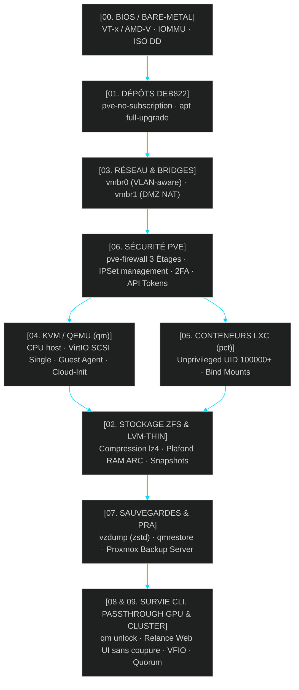

<!-- MASTER-HEADER-START -->
<div align="center">

<a href="https://0xcyberlitech.com/">
  
</a>

<p align="center">
  <a href="https://0xcyberlitech.com/"></a>
  <a href="https://0xcyberlitech.com/soc-rd.html"></a>
  <a href="https://0xcyberlitech.com/jarvis-rd.html"></a>
  <a href="https://github.com/0xCyberLiTech?tab=repositories"></a>
</p>

</div>
<!-- MASTER-HEADER-END -->

<!-- DEBIAN-TRUTH-START -->
> [!IMPORTANT]
>  ** Matrice Officielle Debian — `Debian 12 (Bookworm)` · `Debian 13 (Trixie)` · `Debian 14 (Forky)`**
> - **Sources Officielles Debian.org (`qemu`) :** `Bookworm (12)` : **`Stable-12`** &nbsp;·&nbsp; `Trixie (13 — Stable)` : **`Stable-13`** &nbsp;·&nbsp; `Forky (14 — Next-Gen)` : **`Testing-14`**
> - **Références Officielles :** [Paquet Debian Trixie (`qemu-system-x86`)](https://packages.debian.org/trixie/qemu-system-x86) &nbsp;·&nbsp; [Paquet Debian Forky (`qemu-system-x86`)](https://packages.debian.org/forky/qemu-system-x86) &nbsp;·&nbsp; [Documentation Officielle Debian](https://pve.proxmox.com/pve-docs/)
> - **Note d'Ingénierie (Divergence 13 vs 14) :** Depuis Proxmox VE 8 (Debian 12 Bookworm) et Proxmox VE 9 (Debian 13 Trixie / préparation Debian 14 Forky), les dépôts APT utilisent le format structuré **DEB822 (`/etc/apt/sources.list.d/pve-no-subscription.sources`)** et les mises à jour s'exécutent exclusivement via **`apt full-upgrade`**.

<details>
<summary> <b>Afficher les Encarts Ligne de Commande : Debian 13 (Trixie — Stable) vs Debian 14 (Forky — Next-Gen)</b></summary>

####  Profil Production Stable — Commandes pour `Debian 13 (Trixie)`
```bash
# Proxmox VE 9 (Debian 13 Trixie) — Depot officiel pve-no-subscription au format DEB822 (.sources) :
pveversion -v && pvesm status
apt update && apt full-upgrade -y
```

####  Profil Anticipation Next-Gen — Commandes pour `Debian 14 (Forky)`
```bash
# Debian 14 (Forky — Next-Gen) & Noyau Proxmox 6.14+ : Format DEB822 strict, ZFS 2.3+ & proxmox-boot-tool :
proxmox-boot-tool status && zpool status -x
qm list && pct list
```

</details>
<!-- DEBIAN-TRUTH-END -->

<!-- CIEL-PEDAGOGY-START -->
> [!TIP]
>  **Guide de Lecture &amp; Progression par Niveau (Proxmox)**
> - **Rôle de la brique :** **Proxmox Virtual Environment (Proxmox VE 8 & 9)** est un hyperviseur bare-metal de classe entreprise basé sur Debian combinant la virtualisation matérielle complète **KVM/QEMU (`qm`)**, les conteneurs système légers **LXC (`pct`)**, le stockage **ZFS / LVM-Thin (`pvesm`)**, la commutation réseau **Bridge/VLAN (`vmbr`)** et le pare-feu distribué **`pve-firewall`**.
> - **Parcours recommandé :** **Niveau 1 (Fondamentaux &amp; Installation initiale)** pour déployer une base saine &rarr; **Niveau 2 (Configuration &amp; Intégration)** &rarr; **Niveau 3 (Haute Disponibilité, Durcissement &amp; Exploitation)**.

<details>
<summary> <b>Synthèse d'Architecture, Standards Officiels &amp; Diagnostic (Niveau 1 : Fondamentaux · Niveau 2 : Repères · Niveau 3 : Diagnostic)</b></summary>

- **Niveau 1 — Fondamentaux &amp; Principe d'Architecture :** **Proxmox Virtual Environment (Proxmox VE 8 & 9)** est un hyperviseur bare-metal de classe entreprise basé sur Debian combinant la virtualisation matérielle complète **KVM/QEMU (`qm`)**, les conteneurs système légers **LXC (`pct`)**, le stockage **ZFS / LVM-Thin (`pvesm`)**, la commutation réseau **Bridge/VLAN (`vmbr`)** et le pare-feu distribué **`pve-firewall`**.
- **Niveau 2 — Repères Officiels (Ports IANA, Fichiers Debian &amp; Commandes de Validation) :** **Ports Officiels :** `TCP 8006` (Web UI & API REST HTTPS) · `TCP 22` (SSH) · `TCP 5900-5999` (VNC) · `UDP 5405-5412` (Corosync Cluster) &nbsp;|&nbsp; **Fichiers clés :** `/etc/pve/` (`pmxcfs`), `/etc/network/interfaces`, `/etc/pve/storage.cfg` &nbsp;|&nbsp; **Validation officielle :** `pveversion -v && pvesm status && qm list && pct list`.
- **Niveau 3 — Diagnostic d'Incidents &amp; Ingénierie Avancée :** **Diagnostic & Architecture :** En cas de blocage de l'interface Web `:8006`, relancez `systemctl restart pveproxy pvedaemon pvestatd` (zéro coupure des VMs). Activez toujours l'`IPSet` réservé **`management`** avant d'activer `pve-firewall`, plafonnez l'ARC ZFS en RAM (`zfs_arc_max`), privilégiez les conteneurs LXC non-privilégiés (`unprivileged=1`) et validez vos sauvegardes `vzdump` (`.vma.zst` / `.tar.zst`) par un test de restauration isolé (`qmrestore --unique 1` avec `link_down=1`).
- **Sources de Vérité Officielles Éditeurs &amp; Standards :** [Documentation Officielle Proxmox VE (`pve-docs`)](https://pve.proxmox.com/pve-docs/) &nbsp;·&nbsp; [Wiki Officiel Proxmox VE](https://pve.proxmox.com/wiki/Main_Page) &nbsp;·&nbsp; [Documentation Proxmox Backup Server (PBS)](https://pbs.proxmox.com/docs/)

</details>
<!-- CIEL-PEDAGOGY-END -->


#  Atelier Proxmox VE — Du Montage Bare-Metal & BIOS jusqu'à l'Exploitation Haute Disponibilité & PRA

##  01 // PRÉSENTATION DE L'ATELIER PROXMOX VE & PARCOURS CONSTRUCTIF EN 10 CHAPITRES (DE A À Z)


Cet atelier constitue un **guide complet et 100 % autonome en 10 chapitres chronologiques** permettant de monter, paramétrer, sécuriser et dépanner au quotidien un hyperviseur **Proxmox Virtual Environment (Proxmox VE 8 sous Debian 12 Bookworm & Proxmox VE 9 sous Debian 13 Trixie)** sans avoir besoin de chercher des informations dispersées ailleurs.

> [!NOTE]
> **Pourquoi une progression chronologique de `00` à `09` ?**
> Dans Proxmox VE, la majorité des blocages au quotidien viennent d'étapes réalisées dans le désordre : oublier d'activer `VT-d / IOMMU` dans le BIOS avant l'installation (`Chapitre 00`), tenter un `apt upgrade` au lieu de `apt full-upgrade` ou rester bloqué sur l'erreur `401 Unauthorized` des dépôts Enterprise (`Chapitre 01`), confondre `local`, `local-lvm` et `ZFS` ou laisser le cache ZFS ARC saturer la RAM (`Chapitre 02`), activer le pare-feu `pve-firewall` sans l'`IPSet management` (`Chapitre 06`), ou ne pas savoir déverrouiller une VM bloquée en ligne de commande (`Chapitre 08`). Chaque chapitre ci-dessous s'appuie sur le précédent dans un ordre logique de construction.

---

##  02 // ARCHITECTURE GLOBALE D'UN NŒUD HYPERVISEUR PROXMOX VE




---

##  03 // SOMMAIRE CHRONOLOGIQUE DES 10 CHAPITRES (DU MONTAGE INITIAL AU PRA & CLUSTER)


| Chapitre | Étape du Cycle de Vie | Dossier Technique & Objectif Opérationnel | Système | Accès Direct |
|:---:|:---|:---|:---:|:---:|
| `00` | **0. Montage Bare-Metal & BIOS** | Réglages BIOS/UEFI (`VT-x`, `IOMMU`, `Above 4G`), clé USB mode `DD` & installation ISO pas à pas | `PVE 8 & 9` | [](PROXMOX-00-INSTALLATION-BARE-METAL-BIOS-ZFS-ISO.md) |
| `01` | **1. Dépôts Officiels & Mises à Jour** | Corriger l'erreur `401`, dépôt DEB822 `pve-no-subscription`, clés GPG & règle d'or `apt full-upgrade` | `PVE 8 & 9` | [](Mise_a_jour_Proxmox_VE.md) |
| `02` | **2. Architecture du Stockage** | Démystifier `local`, `local-lvm` et **ZFS (`zpool`/`zfs`)**, plafonner la RAM ARC & Snapshots | `PVE 8 & 9` | [](PROXMOX-02-STOCKAGE-ZFS-LVM-THIN-ARCHITECTURE.md) |
| `03` | **3. Architecture Réseau & NAT** | Ponts Linux (`vmbr0`, `vmbr1`), VLANs 802.1Q, rechargement `ifreload -a`, routage NAT & Rollback | `PVE 8 & 9` | [](Proxmox_configuration.md) |
| `04` | **4. Machines Virtuelles KVM (`qm`)** | Réglages optimaux (`CPU host`, `VirtIO SCSI Single`, `iothread`, `discard`), Guest Agent & Cloud-Init | `PVE 8 & 9` | [](PROXMOX-04-MACHINES-VIRTUELLES-KVM-QEMU-CLOUD-INIT.md) |
| `05` | **5. Conteneurs Linux LXC (`pct`)** | Conteneurs non-privilégiés (`unprivileged`), templates officiels `pveam`, Bind Mounts & Docker | `PVE 8 & 9` | [](PROXMOX-05-CONTENEURS-LXC-UNPRIVILEGED-BIND-MOUNTS.md) |
| `06` | **6. Sécurité, Pare-feu & API** | Pare-feu PVE à 3 étages (`Datacenter`/`Node`/`VM`), `IPSet management` anti-lockout, 2FA & API Tokens | `PVE 8 & 9` | [](PROXMOX-06-SECURITE-PARE-FEU-PVE-2FA-API-TOKENS.md) |
| `07` | **7. Sauvegardes & PRA (`vzdump`)** | Sauvegardes `snapshot` (`zstd`), restauration `qmrestore`/`pct restore` & Proxmox Backup Server | `PVE 8 & 9` | [](Backup_restauration_VM_Proxmox.md) |
| `08` | **8. Guide de Survie CLI Quotidien** | Dépannage d'urgence : débloquer un verrou (`qm unlock`), relancer la Web UI sans coupure & resize | `PVE 8 & 9` | [](PROXMOX-08-GUIDE-SURVIE-CLI-DIAGNOSTIC-QUOTIDIEN.md) |
| `09` | **9. GPU Passthrough & Cluster HA** | Isolation matérielle PCIe / GPU (`IOMMU`/`VFIO`), Cluster multi-nœuds (`pvecm`), `QDevice` & Quorum | `PVE 8 & 9` | [](PROXMOX-09-PCI-PASSTHROUGH-GPU-CLUSTER-HA.md) |

---

##  04 // REPÈRES D'ARCHITECTURE : KVM (`qm`) VS LXC (`pct`)


| Critère Technique | Machine Virtuelle KVM / QEMU (`qm`) | Conteneur Système LXC (`pct`) |
|:---|:---|:---|
| **Isolation noyau** | Noyau dédié par VM (isolation matérielle VT-x / AMD-V complète) | Partage le noyau Linux de l'hôte Proxmox (`pve-kernel`) |
| **Systèmes supportés** | Linux (Debian, Ubuntu, RHEL), BSD, Windows Server / 11, appliances | Distributions Linux uniquement (Debian 12/13, Ubuntu, Alpine) |
| **Empreinte RAM à vide** | `~350 à 512 Mo` minimum par VM | **`~30 à 60 Mo`** seulement par conteneur |
| **Temps de démarrage** | `5 à 15 secondes` (BIOS SeaBIOS / UEFI OVMF + systemd) | **`< 1 seconde`** |
| **Cas d'usage idéal** | Bastion Reverse Proxy/WAF, SIEM, bases critiques, GPU Passthrough | Microservices, orchestrateurs Python/IA, DNS, supervision légère |

<!-- MASTER-FOOTER-START -->
<div align="center">


<a href="https://0xcyberlitech.com/">
  
</a>

<p align="center"><a href="https://0xcyberlitech.com/"></a></p>

<sub><b>Architecturé &amp; Forgé par Marc &amp; Antigravity (Google DeepMind)</b> &nbsp;·&nbsp; <a href="https://0xcyberlitech.com/"><b>0xcyberlitech.com</b></a> &nbsp;·&nbsp; <a href="https://0xcyberlitech.com/soc-rd.html">Architecture SOC Cockpit v5.5</a> &nbsp;·&nbsp; <a href="https://0xcyberlitech.com/jarvis-rd.html">Architecture JARVIS Mark-VII</a> &nbsp;·&nbsp; <a href="https://0xcyberlitech.com/blueprint-jarvis.html">Blueprint Matériel RTX 5080</a></sub>

</div>
<!-- MASTER-FOOTER-END -->
